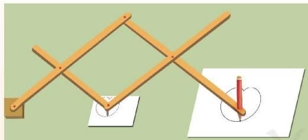
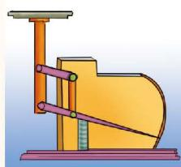
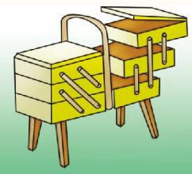
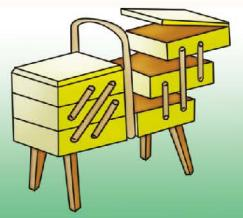
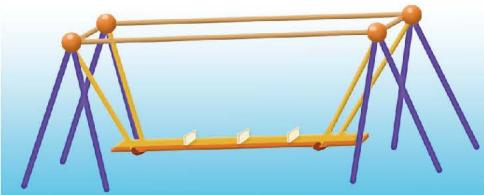

# 平行四边形连杆机构原理与应用

## 情境引入与思考

## 知识讲解

### 北师大版初中数学·八年级下册

阅读·思考

平行四边形是日常生活中常见的图形，如扶梯护栏、居民小区大门的栅栏道闸等。此外，如图 6-17 所示的缩放尺的结构也是平行四边形。

实际上，平行四边形连杆是机械结构中常见的一种部件。这种连杆在移动时，两对边始终保持平行，能方便地进行往复运动。

图6-17

下面有三组平行四边形连杆机械的实例设计图（如图6-18）： $(\mathrm{A}_{1})(\mathrm{A}_{2})$ 是指针式弹簧秤； $(\mathrm{B}_{1})(\mathrm{B}_{2})$ 是活动工具箱； $(\mathrm{C}_{1})(\mathrm{C}_{2})$ 是儿童荡板。每一组设计图中有一幅是合理的，有一幅有一点问题。你知道哪一幅有问题吗？

(A₁)

$(A_{2})$

$(B_{1})$

$(B_{2})$

$(C_{1})$

图6-18

$\left( {\mathrm{C}}_{2}\right)$

## 本节例题与练习

- [6.2 随堂练习第4题](../%E4%B9%A0%E9%A2%98/Q070000003190.md)
- [例3 证明夹在两条平行线间的垂线段相等](../%E4%B9%A0%E9%A2%98/Q070000003188.md)
- [例4 综合运用平行四边形性质与判定证明四边形MENF为平行四边形](../%E4%B9%A0%E9%A2%98/Q070000003189.md)

## 所属组织

- [平行线间的距离与判定综合应用](../%E7%9F%A5%E8%AF%86%E4%B8%B2%E8%81%94/%E5%8C%97%E5%B8%88%E5%A4%A7-%E5%85%AB%E5%B9%B4%E7%BA%A7%E4%B8%8B%E5%86%8C/%E7%AC%AC%E5%85%AD%E7%AB%A0%20%E5%B9%B3%E8%A1%8C%E5%9B%9B%E8%BE%B9%E5%BD%A2/2%20%E5%B9%B3%E8%A1%8C%E5%9B%9B%E8%BE%B9%E5%BD%A2%E7%9A%84%E5%88%A4%E5%AE%9A/%E5%B9%B3%E8%A1%8C%E7%BA%BF%E9%97%B4%E7%9A%84%E8%B7%9D%E7%A6%BB%E4%B8%8E%E5%88%A4%E5%AE%9A%E7%BB%BC%E5%90%88%E5%BA%94%E7%94%A8.md)

## 相关练习组织（范围关联）

- [平行线间的距离与判定综合应用](../%E9%A2%98%E5%9E%8B/%E6%8C%89%E7%AB%A0%E8%8A%82%E5%88%86%E7%B1%BB/%E5%8C%97%E5%B8%88%E5%A4%A7-%E5%85%AB%E5%B9%B4%E7%BA%A7%E4%B8%8B%E5%86%8C/%E7%AC%AC%E5%85%AD%E7%AB%A0%20%E5%B9%B3%E8%A1%8C%E5%9B%9B%E8%BE%B9%E5%BD%A2/%E5%B9%B3%E8%A1%8C%E5%9B%9B%E8%BE%B9%E5%BD%A2%E7%9A%84%E5%88%A4%E5%AE%9A.md)
