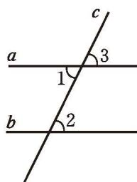

定理 两条直线被第三条直线所截，如果内错角相等，那么这两条直线平行。

简述为：内错角相等，两直线平行。

已知：如图 7-6， $\angle1$ 和 $\angle2$ 是直线 a, b 被直线 c 截出的内错角，且 $\angle1=\angle2$ 。

求证： $a / / b$ 。

分析：现在有哪些结论可以用来证明两条直线平行？能利用“同位角相等，两直线平行”这一基本事实吗？

图7-6

证明：∵ $\angle1=\angle2$ （已知），

$\angle1=\angle3$ （对顶角相等），

∴ $\angle3=\angle2$ （等量代换）。

∴ $a \parallel b$ (同位角相等，两直线平行)。
