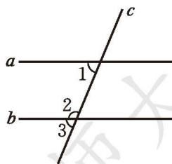

# 平行线判定定理：同旁内角互补，两直线平行（含证明与依据小结）

## 北师大版初中数学·八年级上册

定理 两条直线被第三条直线所截，如果同旁内角互补，那么这两条直线平行。

简述为：同旁内角互补，两直线平行。

已知：如图 7-7，∠1 和 ∠2 是直线 a，b 被直线 c 截出的同旁内角，且 ∠1 与 ∠2 互补。

求证： $a / / b$ 。

证明：∵ $\angle1$ 与 $\angle2$ 互补（已知），

∴ $\angle1+\angle2=180^{\circ}$ （互补的定义）。

图7-7

∴ $\angle1=180^{\circ}-\angle2$ (等式的性质)。

$\because \angle3+\angle2=180^{\circ}$ （平角的定义），

∴ $\angle3=180^{\circ}-\angle2$ (等式的性质)。

∴ $\angle1=\angle3$ （等量代换）。

∴ $a \parallel b$ (同位角相等，两直线平行)。

已给的基本事实、定义和已经证明的定理以后都可以作为依据，用来证明新的结论。
