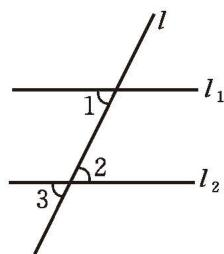

# 平行线性质定理：两直线平行，内错角相等 与 两直线平行，同旁内角互补

## 情境引入与思考

## 知识讲解

### 北师大版初中数学·八年级上册

利用上面的定理，我们可以证明：

定理 两条平行直线被第三条直线所截，内错角相等。

简述为：两直线平行，内错角相等。

已知：如图7-11，直线 $l_{1} \parallel l_{2}$ ， $\angle 1$ 和 $\angle 2$ 是直线 $l_{1}, l_{2}$ 被直线 $l$ 截出的内错角。

求证： $\angle 1 = \angle 2$ 。

图7-11

分析：由条件 $l_{1} \parallel l_{2}$ 可以得到哪些角的等量关系，这些等量关系中的角与 $\angle 1, \angle 2$ 有什么联系？

证明：∵ $l_{1} \parallel l_{2}$ （已知），

∴ $\angle1=\angle3$ （两直线平行，同位角相等）。

又∵ $\angle2=\angle3$ （对顶角相等），

∴ $\angle1=\angle2$ （等量代换）。

类似地，还可以证明：

定理 两条平行直线被第三条直线所截，同旁内角互补。

简述为：两直线平行，同旁内角互补。

平行线的性质定理与判定定理在条件和结论方面有什么关系？

## 本节例题与练习

- [7.3.2 随堂练习 第1题](../%E4%B9%A0%E9%A2%98/Q070000002758.md)
- [例 证明平行于同一条直线的两条直线平行](../%E4%B9%A0%E9%A2%98/Q070000002757.md)

## 所属组织

- [7.3.2 平行线的性质定理与平行传递性](../%E7%9F%A5%E8%AF%86%E4%B8%B2%E8%81%94/%E5%8C%97%E5%B8%88%E5%A4%A7-%E5%85%AB%E5%B9%B4%E7%BA%A7%E4%B8%8A%E5%86%8C/%E7%AC%AC%E4%B8%83%E7%AB%A0%20%E8%AF%81%E6%98%8E/3%20%E5%B9%B3%E8%A1%8C%E7%BA%BF%E7%9A%84%E8%AF%81%E6%98%8E/7.3.2%20%E5%B9%B3%E8%A1%8C%E7%BA%BF%E7%9A%84%E6%80%A7%E8%B4%A8%E5%AE%9A%E7%90%86%E4%B8%8E%E5%B9%B3%E8%A1%8C%E4%BC%A0%E9%80%92%E6%80%A7.md)

## 相关练习组织（范围关联）

- [7.3.2 平行线的性质定理与平行传递性](../%E9%A2%98%E5%9E%8B/%E6%8C%89%E7%AB%A0%E8%8A%82%E5%88%86%E7%B1%BB/%E5%8C%97%E5%B8%88%E5%A4%A7-%E5%85%AB%E5%B9%B4%E7%BA%A7%E4%B8%8A%E5%86%8C/%E7%AC%AC%E4%B8%83%E7%AB%A0%20%E8%AF%81%E6%98%8E/%E5%B9%B3%E8%A1%8C%E7%BA%BF%E7%9A%84%E8%AF%81%E6%98%8E.md)
