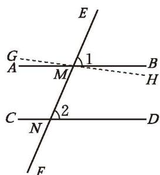

我们已经探索过平行线的性质，下面证明它们。

定理 两条平行直线被第三条直线所截，同位角相等。

简述为：两直线平行，同位角相等。

已知: 如图 7-9, 直线 $AB \parallel CD$ , $\angle 1$ 和 $\angle 2$ 是直线 $AB$ , $CD$ 被直线 $EF$ 截出的同位角。

求证： $\angle1=\angle2$ 。

图7-9

如果 $\angle 1 \neq \angle 2$ , $AB$ 与 $CD$ 的位置关系会怎样呢?

证明 ①：假设 $\angle 1 \neq \angle 2$ ，那么我们可以过点 $M$ 作直线 $GH$ ，使 $\angle EMH = \angle 2$ ，如图7-10所示。

根据 “同位角相等, 两直线平行”, 可知 $GH \parallel CD$ 。

又因为 $AB \parallel CD$ ，这样经过点 $M$ 存在两条直线 $AB$ 和 $GH$ 都与直线 $CD$ 平行。

图7-10

这与基本事实 “过直线外一点有且只有一条直线与这条直线平行” 相矛盾。

这说明 $\angle 1 \neq \angle 2$ 的假设不成立，所以 $\angle 1 = \angle 2$ 。
