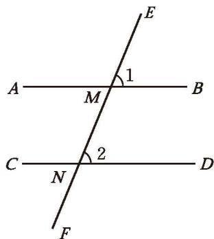

# 平行线性质定理：两直线平行，同位角相等（含反证法证明）

## 情境引入与思考

## 知识讲解

### 北师大版初中数学·八年级上册

我们已经探索过平行线的性质，下面证明它们。

定理 两条平行直线被第三条直线所截，同位角相等。

简述为：两直线平行，同位角相等。

已知: 如图 7-9, 直线 $AB \parallel CD$ , $\angle 1$ 和 $\angle 2$ 是直线 $AB$ , $CD$ 被直线 $EF$ 截出的同位角。

求证： $\angle1=\angle2$ 。

图7-9

如果 $\angle 1 \neq \angle 2$ , $AB$ 与 $CD$ 的位置关系会怎样呢?

证明 ①：假设 $\angle 1 \neq \angle 2$ ，那么我们可以过点 $M$ 作直线 $GH$ ，使 $\angle EMH = \angle 2$ ，如图7-10所示。

根据 “同位角相等, 两直线平行”, 可知 $GH \parallel CD$ 。

又因为 $AB \parallel CD$ ，这样经过点 $M$ 存在两条直线 $AB$ 和 $GH$ 都与直线 $CD$ 平行。

图7-10

这与基本事实 “过直线外一点有且只有一条直线与这条直线平行” 相矛盾。

这说明 $\angle 1 \neq \angle 2$ 的假设不成立，所以 $\angle 1 = \angle 2$ 。

## 本节例题与练习

- [7.3.2 随堂练习 第1题](../%E4%B9%A0%E9%A2%98/Q070000002758.md)
- [例 证明平行于同一条直线的两条直线平行](../%E4%B9%A0%E9%A2%98/Q070000002757.md)

## 所属组织

- [7.3.2 平行线的性质定理与平行传递性](../%E7%9F%A5%E8%AF%86%E4%B8%B2%E8%81%94/%E5%8C%97%E5%B8%88%E5%A4%A7-%E5%85%AB%E5%B9%B4%E7%BA%A7%E4%B8%8A%E5%86%8C/%E7%AC%AC%E4%B8%83%E7%AB%A0%20%E8%AF%81%E6%98%8E/3%20%E5%B9%B3%E8%A1%8C%E7%BA%BF%E7%9A%84%E8%AF%81%E6%98%8E/7.3.2%20%E5%B9%B3%E8%A1%8C%E7%BA%BF%E7%9A%84%E6%80%A7%E8%B4%A8%E5%AE%9A%E7%90%86%E4%B8%8E%E5%B9%B3%E8%A1%8C%E4%BC%A0%E9%80%92%E6%80%A7.md)

## 相关练习组织（范围关联）

- [7.3.2 平行线的性质定理与平行传递性](../%E9%A2%98%E5%9E%8B/%E6%8C%89%E7%AB%A0%E8%8A%82%E5%88%86%E7%B1%BB/%E5%8C%97%E5%B8%88%E5%A4%A7-%E5%85%AB%E5%B9%B4%E7%BA%A7%E4%B8%8A%E5%86%8C/%E7%AC%AC%E4%B8%83%E7%AB%A0%20%E8%AF%81%E6%98%8E/%E5%B9%B3%E8%A1%8C%E7%BA%BF%E7%9A%84%E8%AF%81%E6%98%8E.md)
