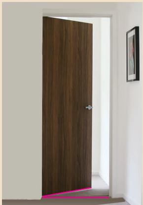
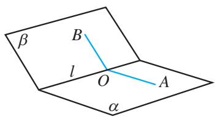
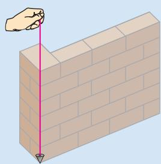

# 平面与平面垂直的判定及性质

## 高中必修 第二册·人教A版数学

思考

如图 8.6-22，在日常生活中，我们常说“把门开大一些”，是指哪个角大一些？受此启发，你认为应该怎样刻画二面角的大小呢？

  
图8.6-22

如图8.6-23，在二面角 $\alpha - l - \beta$ 的棱 $l$ 上任取一点 $O$ ，以点 $O$ 为垂足，在半平面 $\alpha$ 和 $\beta$ 内分别作垂直于棱 $l$ 的射线 $OA$ 和 $OB$ ，则射线 $OA$ 和 $OB$ 构成的 $\angle AOB$ 叫做二面角的平面角.

  
图8.6-23

?

$\angle AOB$ 的大小与点 $O$ 在 $l$ 上的位置有关吗？为什么？

二面角的大小可以用它的平面角来度量，二面角的平面角是多少度，就说这个二面角是多少度。平面角是直角的二面角叫做直二面角。二面角的平面角 $\alpha$ 的取值范围是 $0^{\circ} \leqslant \alpha \leqslant 180^{\circ}$ 。

156 第八章 立体几何初步

观察

教室相邻的两个墙面与地面可以构成几个二面角？分别指出构成这些二面角的面、棱、平面角及其度数.

教室里的墙面所在平面与地面所在平面相交，它们所成的二面角是直二面角，我们常说墙面直立于地面上.

一般地，两个平面相交，如果它们所成的二面角是直二面角，就说这两个平面互相垂直。平面 $\alpha$ 与 $\beta$ 垂直，记作 $\alpha \perp \beta$

如图8.6-24，画两个互相垂直的平面时，通常把表示平面的两个平行四边形的一组边画成垂直.

  
图8.6-24

在明确了两个平面互相垂直的定义的基础上，我们研究两个平面垂直的判定和性质。先研究平面与平面垂直的判定。

观察

如图8.6-25，建筑工人在砌墙时，常用铅锤来检测所砌的墙面与地面是否垂直。如果系有铅锤的细线紧贴墙面，工人师傅就认为墙面垂直于地面，否则他就认为墙面不垂直于地面。这种方法说明了什么道理？

  
图8.6-25

这种方法告诉我们，如果墙面经过地面的垂线，那么墙面与地面垂直。类似的结论也可以在长方体中发现。如图8.6-26，在长方体 $ABCD - A'B'C'D'$ 中，平面 $ABB'A'$ 经过平面 $ABCD$ 的一条垂线 $AA'$ ，此时，平面 $ABB'A'$ 垂直于平面 $ABCD$ 。

一般地，我们有下面判定两个平面互相垂直的定理：

定理 如果一个平面过另一个平面的垂线，那么这两个平面垂直.

图8.6-26

它可以用符号表示为：

$$
a \subset \alpha , a \perp \beta \Rightarrow \alpha \perp \beta .
$$

这个定理说明，可以由直线与平面垂直证明平面与平面垂直.

## 先修知识

- [直线与平面垂直的判定及性质](%E7%9B%B4%E7%BA%BF%E4%B8%8E%E5%B9%B3%E9%9D%A2%E5%9E%82%E7%9B%B4%E7%9A%84%E5%88%A4%E5%AE%9A%E5%8F%8A%E6%80%A7%E8%B4%A8.md)

## 本节例题与练习

- [例 7 如图 8.6-27 所示](../%E4%B9%A0%E9%A2%98/Q070000000766.md)
- [例 8 如图8.6-28](../%E4%B9%A0%E9%A2%98/Q070000000767.md)
- [练习 1](../%E4%B9%A0%E9%A2%98/Q070000000772.md)
- [练习 1](../%E4%B9%A0%E9%A2%98/Q070000000768.md)
- [练习 2](../%E4%B9%A0%E9%A2%98/Q070000000773.md)
- [练习 2](../%E4%B9%A0%E9%A2%98/Q070000000769.md)
- [练习 3](../%E4%B9%A0%E9%A2%98/Q070000000770.md)
- [练习 3](../%E4%B9%A0%E9%A2%98/Q070000000774.md)
- [练习 4](../%E4%B9%A0%E9%A2%98/Q070000000775.md)
- [练习 4](../%E4%B9%A0%E9%A2%98/Q070000000771.md)

## 所属组织

- [8.6.3 平面与平面垂直](../%E7%9F%A5%E8%AF%86%E4%B8%B2%E8%81%94/%E4%BA%BA%E6%95%99A-%E5%BF%85%E4%BF%AE%E7%AC%AC%E4%BA%8C%E5%86%8C/%E7%AC%AC%E5%85%AB%E7%AB%A0%20%E7%AB%8B%E4%BD%93%E5%87%A0%E4%BD%95%E5%88%9D%E6%AD%A5/8.6%20%E7%A9%BA%E9%97%B4%E7%9B%B4%E7%BA%BF%E3%80%81%E5%B9%B3%E9%9D%A2%E7%9A%84%E5%9E%82%E7%9B%B4/8.6.3%20%E5%B9%B3%E9%9D%A2%E4%B8%8E%E5%B9%B3%E9%9D%A2%E5%9E%82%E7%9B%B4.md)

## 相关练习组织（范围关联）

- [8.6.3 平面与平面垂直](../%E9%A2%98%E5%9E%8B/%E6%8C%89%E7%AB%A0%E8%8A%82%E5%88%86%E7%B1%BB/%E4%BA%BA%E6%95%99A-%E5%BF%85%E4%BF%AE%E7%AC%AC%E4%BA%8C%E5%86%8C/%E7%AC%AC%E5%85%AB%E7%AB%A0%20%E7%AB%8B%E4%BD%93%E5%87%A0%E4%BD%95%E5%88%9D%E6%AD%A5/8.6%20%E7%A9%BA%E9%97%B4%E7%9B%B4%E7%BA%BF%E3%80%81%E5%B9%B3%E9%9D%A2%E7%9A%84%E5%9E%82%E7%9B%B4.md)
