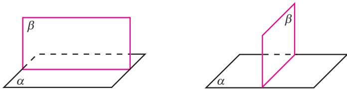
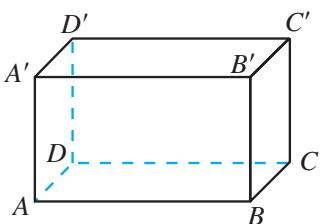

如图8.6-23，在二面角 $\alpha - l - \beta$ 的棱 $l$ 上任取一点 $O$ ，以点 $O$ 为垂足，在半平面 $\alpha$ 和 $\beta$ 内分别作垂直于棱 $l$ 的射线 $OA$ 和 $OB$ ，则射线 $OA$ 和 $OB$ 构成的 $\angle AOB$ 叫做二面角的平面角.

  
图8.6-23

二面角的大小可以用它的平面角来度量，二面角的平面角是多少度，就说这个二面角是多少度。平面角是直角的二面角叫做直二面角。二面角的平面角 $\alpha$ 的取值范围是 $0^{\circ} \leqslant \alpha \leqslant 180^{\circ}$ 。

教室里的墙面所在平面与地面所在平面相交，它们所成的二面角是直二面角，我们常说墙面直立于地面上.

一般地，两个平面相交，如果它们所成的二面角是直二面角，就说这两个平面互相垂直。平面 $\alpha$ 与 $\beta$ 垂直，记作 $\alpha \perp \beta$

如图8.6-24，画两个互相垂直的平面时，通常把表示平面的两个平行四边形的一组边画成垂直.

  
图8.6-24

在明确了两个平面互相垂直的定义的基础上，我们研究两个平面垂直的判定和性质。先研究平面与平面垂直的判定。

如图 8.6-25，建筑工人在砌墙时，常用铅锤来检测所砌的墙面与地面是否垂直：如果系有铅锤的细线紧贴墙面，墙面就垂直于地面，否则就不垂直于地面。

  
图8.6-25

这种方法告诉我们，如果墙面经过地面的垂线，那么墙面与地面垂直。类似的结论也可以在长方体中发现。如图8.6-26，在长方体 $ABCD - A'B'C'D'$ 中，平面 $ABB'A'$ 经过平面 $ABCD$ 的一条垂线 $AA'$ ，此时，平面 $ABB'A'$ 垂直于平面 $ABCD$ 。

一般地，我们有下面判定两个平面互相垂直的定理：

定理 如果一个平面过另一个平面的垂线，那么这两个平面垂直.

图8.6-26

它可以用符号表示为：

$$
a \subset \alpha , a \perp \beta \Rightarrow \alpha \perp \beta .
$$

这个定理说明，可以由直线与平面垂直证明平面与平面垂直.
