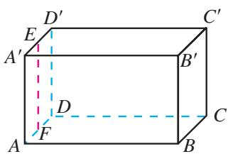
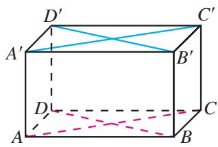
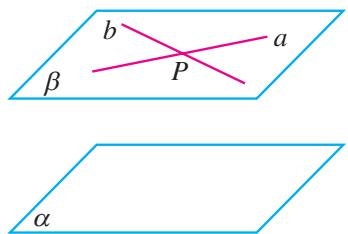
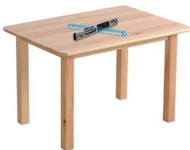

如果一个平面内有两条平行直线与另一个平面平行，这两个平面不一定平行。我们借助长方体模型来说明。如图8.5-12，在平面 $A^{\prime}ADD^{\prime}$ 内画一条与 $A^{\prime}A$ 平行的直线 $EF$ ，显然 $A^{\prime}A$ 与 $EF$ 都平行于平面 $D^{\prime}DCC^{\prime}$ ，但这两条平行直线所在的平面 $A^{\prime}ADD^{\prime}$ 与平面 $D^{\prime}DCC^{\prime}$ 相交。

  
图8.5-12

  
图8.5-13

如果一个平面内有两条相交直线与另一个平面平行，这两个平面是平行的。如图8.5-13的长方体模型中，平面ABCD内两条相交直线AC，BD分别与平面 $A'B'C'D'$ 内两条相交直线 $A'C'$ ， $B'D'$ 平行。由直线与平面平行的判定定理可知，这两条相交直线AC，BD都与平面 $A'B'C'D'$ 平行。此时，平面ABCD平行于平面 $A'B'C'D'$ 。

一般地，我们有如下平面与平面平行的判定定理（图 8.5-14）：

定理 如果一个平面内的两条相交直线与另一个平面平行，那么这两个平面平行. 它可以用符号表示为

$$
a \subset \beta , b \subset \beta , a \cap b = P, a / / \alpha , b / / \alpha \Rightarrow \beta / / \alpha .
$$

  
图8.5-14

  
图8.5-15

这个定理告诉我们, 可以由直线与平面平行判定平面与平面平行. 如图 8.5-15, 工人师傅将水平仪在桌面上交叉放置两次, 如果水平仪的气泡两次都在中央, 就能判断桌面是水平的, 就是应用了这个判定定理.
