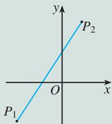
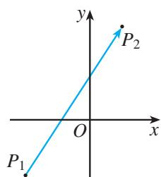

# 平面两点间的距离公式及其推导

## 情境引入与思考

## 知识讲解

### 高中选择性必修 第一册·人教A版数学

我们知道，在各种几何量中，直线段的长度是最基本的。因此，在解析几何中，最基本的公式自然是用平面内两点的坐标表示这两点间距离的公式。

探究

如图 2.3-2，已知平面内两点 $P_{1}(x_{1}, y_{1})$ ， $P_{2}(x_{2}, y_{2})$ ，如何求 $P_{1}$ ， $P_{2}$ 间的距离 $\left|P_{1}P_{2}\right|$ ?

  
图2.3-2

我们用平面向量的知识来解决．如图2.3-3，由点 $P_{1}(x_{1},y_{1})$ ， $P_{2}(x_{2},y_{2})$ ，得 $\overrightarrow{P_1P_2} = (x_2 - x_1,y_2 - y_1)$ ．于是，

$$
\left| \overrightarrow {P _ {1} P _ {2}} \right| = \sqrt {\left(x _ {2} - x _ {1}\right) ^ {2} + \left(y _ {2} - y _ {1}\right) ^ {2}}.
$$

由此得到 $P_{1}(x_{1},y_{1})$ ， $P_{2}(x_{2},y_{2})$ 两点间的距离公式

$$
\left| P _ {1} P _ {2} \right| = \sqrt {\left(x _ {2} - x _ {1}\right) ^ {2} + \left(y _ {2} - y _ {1}\right) ^ {2}}.
$$

特别地，原点 $O(0,0)$ 与任一点 $P(x,y)$ 间的距离

  
图2.3-3

$$
\mid O P \mid = \sqrt {x ^ {2} + y ^ {2}}.
$$

## 后续知识

- [圆的标准方程及其推导](%E5%9C%86%E7%9A%84%E6%A0%87%E5%87%86%E6%96%B9%E7%A8%8B%E5%8F%8A%E5%85%B6%E6%8E%A8%E5%AF%BC.md)

## 本节例题与练习

- [例 3 已知点 $A(-1, 2)$](../%E4%B9%A0%E9%A2%98/Q070000001156.md)
- [例 4 用坐标法证明：平行四边形两条对](../%E4%B9%A0%E9%A2%98/Q070000001157.md)
- [练习 1](../%E4%B9%A0%E9%A2%98/Q070000001158.md)
- [练习 2](../%E4%B9%A0%E9%A2%98/Q070000001159.md)
- [练习 3](../%E4%B9%A0%E9%A2%98/Q070000001160.md)

## 所属组织

- [2.3.2 两点间的距离公式](../%E7%9F%A5%E8%AF%86%E4%B8%B2%E8%81%94/%E4%BA%BA%E6%95%99A-%E9%80%89%E6%8B%A9%E6%80%A7%E5%BF%85%E4%BF%AE%E7%AC%AC%E4%B8%80%E5%86%8C/%E7%AC%AC%E4%BA%8C%E7%AB%A0%20%E7%9B%B4%E7%BA%BF%E5%92%8C%E5%9C%86%E7%9A%84%E6%96%B9%E7%A8%8B/2.3%20%E7%9B%B4%E7%BA%BF%E7%9A%84%E4%BA%A4%E7%82%B9%E5%9D%90%E6%A0%87%E4%B8%8E%E8%B7%9D%E7%A6%BB%E5%85%AC%E5%BC%8F/2.3.2%20%E4%B8%A4%E7%82%B9%E9%97%B4%E7%9A%84%E8%B7%9D%E7%A6%BB%E5%85%AC%E5%BC%8F.md)

## 相关练习组织（范围关联）

- [2.3.2 两点间的距离公式](../%E9%A2%98%E5%9E%8B/%E6%8C%89%E7%AB%A0%E8%8A%82%E5%88%86%E7%B1%BB/%E4%BA%BA%E6%95%99A-%E9%80%89%E6%8B%A9%E6%80%A7%E5%BF%85%E4%BF%AE%E7%AC%AC%E4%B8%80%E5%86%8C/%E7%AC%AC%E4%BA%8C%E7%AB%A0%20%E7%9B%B4%E7%BA%BF%E5%92%8C%E5%9C%86%E7%9A%84%E6%96%B9%E7%A8%8B/2.3%20%E7%9B%B4%E7%BA%BF%E7%9A%84%E4%BA%A4%E7%82%B9%E5%9D%90%E6%A0%87%E4%B8%8E%E8%B7%9D%E7%A6%BB%E5%85%AC%E5%BC%8F.md)
