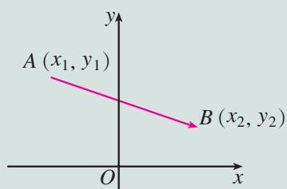
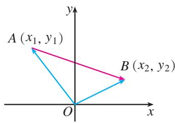

已知 $\boldsymbol{a}=(x_{1},y_{1})$ ， $\boldsymbol{b}=(x_{2},y_{2})$ ，其中 $\boldsymbol{i}, \boldsymbol{j}$ 分别为与 $x$ 轴、 $y$ 轴方向相同的单位向量，则

$$
\begin{array}{r l} \boldsymbol {a} + \boldsymbol {b} & = (x _ {1} \boldsymbol {i} + y _ {1} \boldsymbol {j}) + (x _ {2} \boldsymbol {i} + y _ {2} \boldsymbol {j}) \\ & = x _ {1} \boldsymbol {i} + x _ {2} \boldsymbol {i} + y _ {1} \boldsymbol {j} + y _ {2} \boldsymbol {j} \\ & = (x _ {1} + x _ {2}) \boldsymbol {i} + (y _ {1} + y _ {2}) \boldsymbol {j}, \end{array}
$$

即

$$
\boldsymbol {a} + \boldsymbol {b} = (x _ {1} + x _ {2}, y _ {1} + y _ {2}).
$$

同理可得

$$
\boldsymbol {a} - \boldsymbol {b} = \left(x _ {1} - x _ {2}, y _ {1} - y _ {2}\right).
$$

这就是说，两个向量和（差）的坐标分别等于这两个向量相应坐标的和（差）.

已知点 $A(x_{1}, y_{1})$ ， $B(x_{2}, y_{2})$ （图 6.3-11），如图 6.3-12，作向量 $\overrightarrow{OA}$ ， $\overrightarrow{OB}$ ，则

  
图6.3-11

$$
\begin{array}{r l} \overrightarrow {A B} & = \overrightarrow {O B} - \overrightarrow {O A} \\ & = (x _ {2}, y _ {2}) - (x _ {1}, y _ {1}) \\ & = (x _ {2} - x _ {1}, y _ {2} - y _ {1}). \end{array}
$$

因此，一个向量的坐标等于表示此向量的有向线段的终点的坐标减去起点的坐标.
