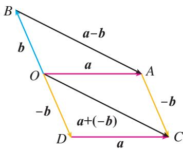
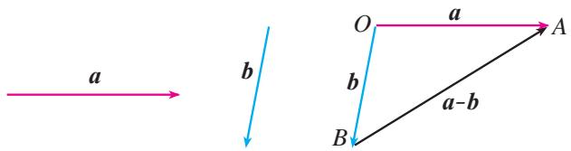

# 平面向量的减法与相反向量

## 情境引入与思考

## 知识讲解

### 高中必修 第二册·人教A版数学

思考

在数的运算中，减法是加法的逆运算，其运算法则是“减去一个数等于加上这个数的相反数”。类比数的减法，向量的减法与加法有什么关系？如何定义向量的减法法则？

与数 $x$ 的相反数是 $-x$ 类似，我们规定，与向量 $a$ 长度相等，方向相反的向量，叫做 $a$ 的相反向量，记作 $-a$ 。由于方向反转两次仍回到原来的方向，因此 $a$ 和 $-a$ 互为相反向量，于是

$$
- (- a) = a.
$$

我们规定，零向量的相反向量仍是零向量.

由两个向量和的定义易知

$$
\boldsymbol {a} + (- \boldsymbol {a}) = (- \boldsymbol {a}) + \boldsymbol {a} = \mathbf {0},
$$

即任意向量与其相反向量的和是零向量. 这样，如果 $a, b$ 互为相反向量，那么

$$
a = - b, b = - a, a + b = 0.
$$

向量 $a$ 加上 $b$ 的相反向量，叫做 $a$ 与 $b$ 的差，即

$$
a - b = a + (- b).
$$

求两个向量差的运算叫做向量的减法.

我们看到，向量的减法可以转化为向量的加法来进行：减去一个向量相当于加上这个向量的相反向量.

探究

向量减法的几何意义是什么？

如图 6.2-10，设 $\overrightarrow{OA}=a,\quad\overrightarrow{OB}=b,\quad\overrightarrow{OD}=-b$ ，连接 AB，由向量减法的定义知

$$
a - b = a + (- b) = \overrightarrow {O A} + \overrightarrow {O D} = \overrightarrow {O C}.
$$

在四边形 OCAB 中， $OB \perp CA$ ，所以 OCAB 是平行四边形。所以

$$
\overrightarrow {B A} = \overrightarrow {O C} = a - b.
$$

由此，我们得到 a-b 的作图方法.

图6.2-10

如图 6.2-11，已知向量 a, b，在平面内任取一点 O，作$\overrightarrow{OA} = a$ ， $\overrightarrow{OB} = b$ ，则 $\overrightarrow{BA} = a - b$ .即 $a - b$ 可以表示为从向量 $\pmb{b}$ 的终点指向向量 $\pmb{a}$ 的终点的向量，这是向量减法的几何意义.

(1)  
  
图6.2-11

## 先修知识

- [平面向量的加法与运算律](%E5%B9%B3%E9%9D%A2%E5%90%91%E9%87%8F%E7%9A%84%E5%8A%A0%E6%B3%95%E4%B8%8E%E8%BF%90%E7%AE%97%E5%BE%8B.md)

## 本节例题与练习

- [例 3 如图 6.2-12（1）](../%E4%B9%A0%E9%A2%98/Q070000000399.md)
- [例 4 如图 6.2-13](../%E4%B9%A0%E9%A2%98/Q070000000400.md)
- [练习 1](../%E4%B9%A0%E9%A2%98/Q070000000401.md)
- [练习 2](../%E4%B9%A0%E9%A2%98/Q070000000402.md)
- [练习 3](../%E4%B9%A0%E9%A2%98/Q070000000403.md)

## 所属组织

- [6.2.2 向量的减法运算](../%E7%9F%A5%E8%AF%86%E4%B8%B2%E8%81%94/%E4%BA%BA%E6%95%99A-%E5%BF%85%E4%BF%AE%E7%AC%AC%E4%BA%8C%E5%86%8C/%E7%AC%AC%E5%85%AD%E7%AB%A0%20%E5%B9%B3%E9%9D%A2%E5%90%91%E9%87%8F%E5%8F%8A%E5%85%B6%E5%BA%94%E7%94%A8/6.2%20%E5%B9%B3%E9%9D%A2%E5%90%91%E9%87%8F%E7%9A%84%E8%BF%90%E7%AE%97/6.2.2%20%E5%90%91%E9%87%8F%E7%9A%84%E5%87%8F%E6%B3%95%E8%BF%90%E7%AE%97.md)

## 相关练习组织（范围关联）

- [6.2.2 向量的减法运算](../%E9%A2%98%E5%9E%8B/%E6%8C%89%E7%AB%A0%E8%8A%82%E5%88%86%E7%B1%BB/%E4%BA%BA%E6%95%99A-%E5%BF%85%E4%BF%AE%E7%AC%AC%E4%BA%8C%E5%86%8C/%E7%AC%AC%E5%85%AD%E7%AB%A0%20%E5%B9%B3%E9%9D%A2%E5%90%91%E9%87%8F%E5%8F%8A%E5%85%B6%E5%BA%94%E7%94%A8/6.2%20%E5%B9%B3%E9%9D%A2%E5%90%91%E9%87%8F%E7%9A%84%E8%BF%90%E7%AE%97.md)
