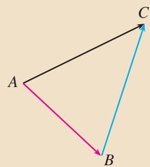
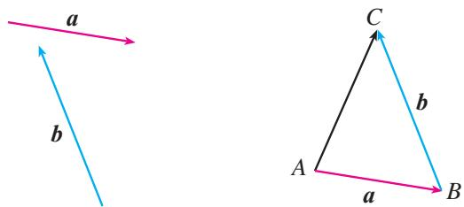
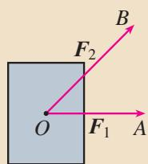
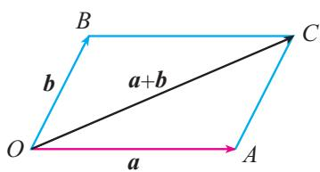
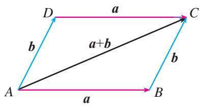
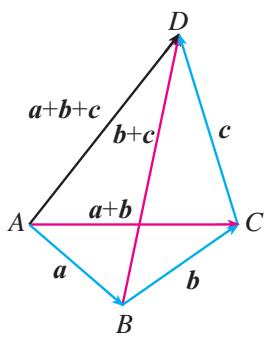

# 平面向量的加法与运算律

## 高中必修 第二册·人教A版数学

思考

如图6.2-1，某质点从点 $A$ 经过点 $B$ 到点 $C$ ，这个质点的位移如何表示？

  
图6.2-1

物理知识告诉我们，这个质点两次位移 $\overrightarrow{AB}$ ， $\overrightarrow{BC}$ 的结果，与从点 $A$ 直接到点 $C$ 的位移 $\overrightarrow{AC}$ 结果相同。因此，位移 $\overrightarrow{AC}$ 可以看作位移 $\overrightarrow{AB}$ 与 $\overrightarrow{BC}$ 合成的。数的加法启发我们，从运算的角度看， $\overrightarrow{AC}$ 可以看作 $\overrightarrow{AB}$ 与 $\overrightarrow{BC}$ 的和，即位移的合成可以看作向量的加法。

如图 6.2-2，已知非零向量 a, b，在平面内取任意一点 A，作 $\overrightarrow{AB}=a,\overrightarrow{BC}=b$ ，则向量 $\overrightarrow{AC}$ 叫做 a 与 b 的和，记作 $a+b$ ，即 $a+b=\overrightarrow{AB}+\overrightarrow{BC}=\overrightarrow{AC}$ .

  
图6.2-2

求两个向量和的运算，叫做向量的加法. 这种求向量和的方法，称为向量加法的三角形法则. 位移的合成可以看作向量加法三角形法则的物理模型.

我们再来看力的合成问题.

思考

如图6.2-3，在光滑的平面上，一个物体同时受到两个外力 $\mathbf{F}_1$ 与 $\mathbf{F}_2$ 的作用，你能作出这个物体所受的合力 $\mathbf{F}$ 吗？

  
图6.2-3

我们知道，合力 $\pmb{F}$ 在以 $OA$ ，OB为邻边的平行四边形的对角线上，并且大小等于这条对角线的长.从运算的角度看， $\pmb{F}$ 可以看作 $\pmb{F}_{1}$ 与 $\pmb{F}_{2}$ 的和，即力的合成可以看作向量的加法.

如图 6.2-4，以同一点 O 为起点的两个已知向量 a，b，以 OA，OB 为邻边作 □OACB，则以 O 为起点的向量 $\overrightarrow{OC}$ （OC 是 □OACB 的对角线）就是向量 a 与 b 的和。我们把这种作两个向量和的方法叫做向量加法的平行四边形法则。力的合成可以看作向量加法平行四边形法则的物理模型。

  
图6.2-4

思考

向量加法的平行四边形法则与三角形法则一致吗？为什么？

对于零向量与任意向量 $a$ ，我们规定

$$
a + 0 = 0 + a = a.
$$

探究

（1）如果向量 $a, b$ 共线，它们的加法与数的加法有什么关系？你能作出向量 $a + b$ 吗？

(2) 结合例 1，探索 $\left|a+b\right|$ ， $\left|a\right|$ ， $\left|b\right|$ 之间的关系.

一般地，我们有

$$
\left| a + b \right| \leqslant \left| a \right| + \left| b \right|,
$$

当且仅当 a, b 中有一个是零向量或 a, b 是方向相同的非零向量时，等号成立.

根据数的运算的学习经验，定义了一种运算，就要研究相应的运算律，运算律可以有效地简化运算.

探究

数的加法满足交换律、结合律，向量的加法是否也满足交换律和结合律呢？

如图6.2-7（1），作 $\overrightarrow{AB} = a$ ， $\overrightarrow{AD} = b$ ，以 $AB$ ， $AD$ 为邻边作□ABCD，容易发现 $\overrightarrow{BC} = b$ ， $\overrightarrow{DC} = a$ ，故 $\overrightarrow{AC} = \overrightarrow{AB} +\overrightarrow{BC} = a + b.$ 又 $\overrightarrow{AC} = \overrightarrow{AD} +\overrightarrow{DC} = b + a$ ，所以 $a + b = b + a$

  
(1)

  
(2)  
图6.2-7

由图6.2-7（2），你能否验证

$$
(a + b) + c = a + (b + c)?
$$

综上所述，向量的加法满足交换律和结合律.
