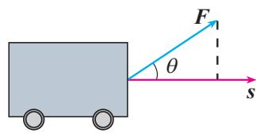
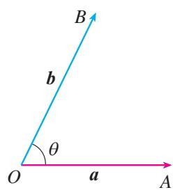
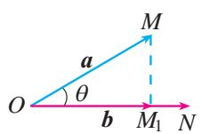
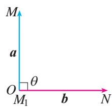
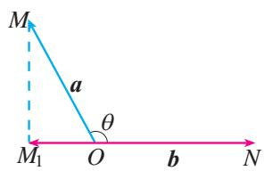

在物理课中我们学过功的概念. 一般地, 如果一个物体在力 $\mathbf{F}$ 的作用下产生位移 $s$ (图6.2-18), 那么力 $\mathbf{F}$ 所做的功

  
图6.2-18

$$
W = | \boldsymbol {F} | | \boldsymbol {s} | \cos \theta ,
$$

其中 $\theta$ 是 F 与 s 的夹角.

功是一个标量，它由力和位移两个向量来确定。这给我们一种启示，能否把“功”看作两个向量“相乘”的结果呢？受此启发，我们引入向量“数量积”的概念。

因为力做功的计算公式中涉及力与位移的夹角，所以我们先要定义向量的夹角概念.

已知两个非零向量 a, b （图 6.2-19），O 是平面上的任意一点，作 $\overrightarrow{OA}=a,\overrightarrow{OB}=b$ ，则 $\angle AOB=\theta(0\leqslant\theta\leqslant\pi)$ 叫做向量 a 与 b 的夹角.

  
图6.2-19

显然，当 $\theta=0$ 时，a 与 b 同向；当 $\theta=\pi$ 时，a 与 b 反向.

如果 $a$ 与 $b$ 的夹角是 $\frac{\pi}{2}$ ，我们说 $a$ 与 $b$ 垂直，记作 $a \perp b$ .

已知两个非零向量 a 与 b，它们的夹角为 $\theta$ ，我们把数量 $|a||b|\cos\theta$ 叫做向量 a 与 b 的数量积（或内积（inner product）），记作 $a \cdot b$ ，即

$$
\boldsymbol {a} \cdot \boldsymbol {b} = | \boldsymbol {a} | | \boldsymbol {b} | \cos \theta .
$$

$a, b$ 的夹角记作 $\langle a, b \rangle$ .

规定：零向量与任一向量的数量积为0.

对比向量的线性运算，我们发现，向量线性运算的结果是一个向量，而两个向量的数量积是一个数量，这个数量的大小与两个向量的长度及其夹角有关.

设向量 $\pmb{a}$ 在向量 $\pmb{b}$ 上的投影向量为 $\overrightarrow{OM_1}$ ，与 $\pmb{b}$ 方向相同的单位向量为 $\pmb{e}$ ， $\pmb{a}$ 与 $\pmb{b}$ 的夹角为 $\theta$ 。显然， $\overrightarrow{OM_1}$ 与 $e$ 共线，于是

$$
\overrightarrow {O M _ {1}} = \lambda e.
$$

下面我们探究 $\lambda$ 与 $a, \theta$ 的关系，进而给出 $\overrightarrow{OM_1}$ 的明确表达式。我们分 $\theta$ 为锐角、直角、钝角以及 $\theta = 0, \theta = \pi$ 等情况进行讨论。

当 $\theta$ 为锐角（图6.2-21(1))时， $\overrightarrow{OM_1}$ 与 $\pmb{e}$ 方向相同， $\lambda = |\overrightarrow{OM_1}| = |\pmb {a}|\cos \theta$ ，所以

$$
\overrightarrow {O M _ {1}} = | \overrightarrow {O M _ {1}} | e = | a | \cos \theta e;
$$

当 $\theta$ 为直角（图 6.2-21(2)）时， $\lambda=0$ ，所以

$$
\overrightarrow {O M _ {1}} = \mathbf {0} = | \boldsymbol {a} | \cos \frac {\pi}{2} \boldsymbol {e};
$$

当 $\theta$ 为钝角（图6.2-21(3))时， $\overrightarrow{OM_1}$ 与 $\pmb{e}$ 方向相反，所以

$$
\begin{array}{r l} \lambda & = - | \overrightarrow {O M _ {1}} | = - | \boldsymbol {a} | \cos \angle M O M _ {1} \\ & = - | \boldsymbol {a} | \cos (\pi - \theta) = | \boldsymbol {a} | \cos \theta , \end{array}
$$

即

$$
\overrightarrow {O M _ {1}} = | \boldsymbol {a} | \cos \theta \boldsymbol {e};
$$

(1)

  
(2)

  
(3)  
图6.2-21

当 $\theta = 0$ 时， $\lambda = |a|$ ，所以

$$
\overrightarrow {O M _ {1}} = | \boldsymbol {a} | \boldsymbol {e} = | \boldsymbol {a} | \cos 0 \boldsymbol {e};
$$

当 $\theta = \pi$ 时， $\lambda = -|a|$ ，所以

$$
\overrightarrow {O M _ {1}} = - | \boldsymbol {a} | e = | \boldsymbol {a} | \cos \pi \boldsymbol {e}.
$$

从上面的讨论可知，对于任意的 $\theta \in [0, \pi]$ ，都有

$$
\overrightarrow {O M _ {1}} = | \textbf {\textit {a}} | \cos \theta \textbf {\textit {e}}.
$$

当两个非零向量 $a$ 与 $b$ 相互平行或垂直时，向量 $a$ 在向量 $b$ 上的投影向量及其数量积都具有特殊性。由向量数量积的定义，可以得到向量数量积的如下重要性质.

设 a, b 是非零向量，它们的夹角是 $\theta$ ，e 是与 b 方向相同的单位向量，则

(1) $a \cdot e = e \cdot a = |a| \cos \theta$ .

(2) $a \perp b \Leftrightarrow a \cdot b = 0.$

（3）当 $a$ 与 $b$ 同向时， $a \cdot b = |a||b|$ ；当 $a$ 与 $b$ 反向时， $a \cdot b = -|a||b|$ . 特别地， $a \cdot a = |a|^2$ 或 $|a| = \sqrt{a \cdot a}$ .

$a \cdot a$ 常常记作 $a^{2}$ .

此外，由 $|\cos \theta |\leqslant 1$ 还可以得到

(4) $|a \cdot b| \leqslant |a||b|$ .
