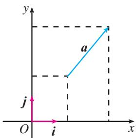
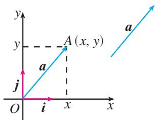

如图 6.3-8，在平面直角坐标系中，设与 x 轴、y 轴方向相同的两个单位向量分别为 i, j，取 $\{i, j\}$ 作为基底。对于平面内的任意一个向量 a，由平面向量基本定理可知，有且只有一对实数 x, y，使得

$$
\boldsymbol {a} = x \boldsymbol {i} + y \boldsymbol {j}.
$$

这样，平面内的任一向量 a 都可由 x，y 唯一确定，我们把有序数对 $(x, y)$ 叫做向量 a 的坐标，记作

$$
\boldsymbol {a} = (x, y).\tag{①}
$$

  
图6.3-8

其中，x 叫做 a 在 x 轴上的坐标，y 叫做 a 在 y 轴上的坐标，①叫做向量 a 的坐标表示.

显然， $i=(1,0)$ ， $j=(0,1)$ ， $0=(0,0)$ .

如图 6.3-9，在直角坐标平面中，以原点 O 为起点作 $\overrightarrow{OA}=a$ ，则点 A 的位置由向量 a 唯一确定.

设 $\overrightarrow{OA} = xi + yj$ ，则向量 $\overrightarrow{OA}$ 的坐标（ $x$ ，y）就是终点 $A$ 的坐标；反过来，终点 $A$ 的坐标（ $x$ ，y）也就是向量 $\overrightarrow{OA}$ 的坐标.因为 $\overrightarrow{OA} = a$ ，所以终点 $A$ 的坐标（ $x$ ，y）就是向量 $a$ 的坐标.这样就建立了向量的坐标与点的坐标之间的联系.

  
图6.3-9
