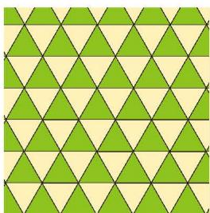
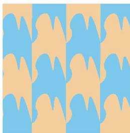

我们常常在地面、墙面、服装面料上见到由一种或几种形状相同的图形拼接而成的图案（如图1）。像这样，用形状、大小完全相同的一种或几种平面图形进行拼接，彼此之间不留空隙、不重叠地铺成一片，就是平面图形的镶嵌。荷兰艺术家埃舍尔（Maurits Cornelis Escher，1898—1972）运用镶嵌创造了许多令人印象深刻的艺术作品。组成合作小组，一起探索图形镶嵌的奥秘，设计独特的镶嵌图案吧。

图1
