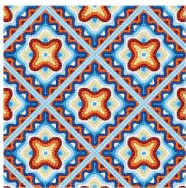
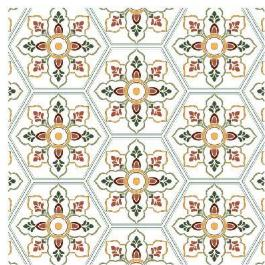

# 平面图形的镶嵌概念

## 情境引入与思考

## 知识讲解

### 北师大版初中数学·八年级下册

我们常常在地面、墙面、服装面料上见到由一种或几种形状相同的图形拼接而成的图案（如图1）。像这样，用形状、大小完全相同的一种或几种平面图形进行拼接，彼此之间不留空隙、不重叠地铺成一片，就是平面图形的镶嵌。荷兰艺术家埃舍尔（Maurits Cornelis Escher，1898—1972）运用镶嵌创造了许多令人印象深刻的艺术作品。组成合作小组，一起探索图形镶嵌的奥秘，设计独特的镶嵌图案吧。

图1

## 所属组织

- [设计美丽的镶嵌图案](../%E7%9F%A5%E8%AF%86%E4%B8%B2%E8%81%94/%E5%8C%97%E5%B8%88%E5%A4%A7-%E5%85%AB%E5%B9%B4%E7%BA%A7%E4%B8%8B%E5%86%8C/%E7%BB%BC%E5%90%88%E4%B8%8E%E5%AE%9E%E8%B7%B5/%E8%AE%BE%E8%AE%A1%E7%BE%8E%E4%B8%BD%E7%9A%84%E9%95%B6%E5%B5%8C%E5%9B%BE%E6%A1%88.md)

## 相关练习组织（范围关联）

- [义务教育教科书 数学 八年级 下册（2024北师大版）](../%E9%A2%98%E5%9E%8B/%E6%8C%89%E7%AB%A0%E8%8A%82%E5%88%86%E7%B1%BB/%E5%8C%97%E5%B8%88%E5%A4%A7-%E5%85%AB%E5%B9%B4%E7%BA%A7%E4%B8%8B%E5%86%8C/%E5%8C%97%E5%B8%88%E5%A4%A7-%E5%85%AB%E5%B9%B4%E7%BA%A7%E4%B8%8B%E5%86%8C.md)
