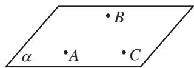
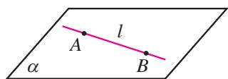
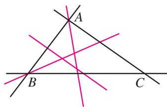
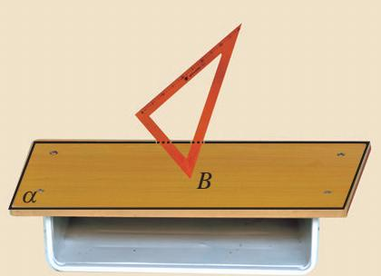
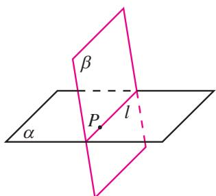
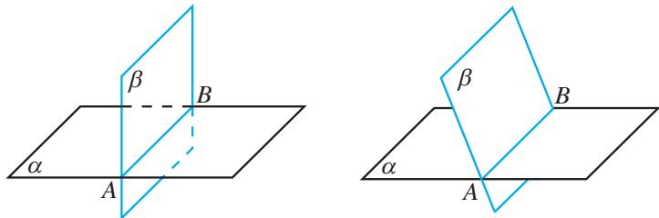
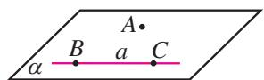
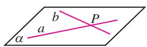
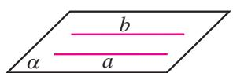
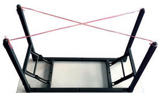

# 平面的表示与基本性质

## 高中必修 第二册·人教A版数学

思考

我们知道，两点可以确定一条直线，那么几点可以确定一个平面？

124 第八章 立体几何初步

  
图8.4-2

在日常生活中，我们常常可以看到这样的现象：自行车用一个脚架和两个车轮着地就可以“站稳”，三脚架的三脚着地就可以支撑照相机（图 8.4-2）。由这些事实和类似经验，可以得到下面的基本事实：

基本事实1 过不在一条直线上的三个点，有且只有一个平面（图8.4-3）.

基本事实 1 给出了确定一个平面的依据. 它也可以简单说成 “不共线的三点确定一个平面”. 不在一条直线上的三个点 A, B, C 所确定的平面, 可以记成平面 ABC.

图8.4-3

直线上有无数个点，平面内有无数个点，直线、平面都可以看作点的集合。点 $A$ 在直线 $l$ 上，记作 $A \in l$ ；点 $B$ 在直线 $l$ 外，记作 $B \notin l$ ；点 $A$ 在平面 $\alpha$ 内，记作 $A \in \alpha$ ；点 $P$ 在平面 $\alpha$ 外，记作 $P \notin \alpha$ 。

思考

如果直线 $l$ 与平面 $\alpha$ 有一个公共点 $P$ ，直线 $l$ 是否在平面 $\alpha$ 内？如果直线 $l$ 与平面 $\alpha$ 有两个公共点呢？

在实际生活中，我们有这样的经验：如果一根直尺边缘上的任意两点在桌面上，那么直尺的整个边缘就落在了桌面上．上述经验和类似的事实可以归纳为以下基本事实：

基本事实 2 如果一条直线上的两个点在一个平面内，那么这条直线在这个平面内（图 8.4-4）.

利用基本事实 2，可以判断直线是否在平面内.

平面内有无数条直线，平面可以看作直线的集合。如果直线 $l$ 上所有点都在平面 $\alpha$ 内，就说直线 $l$ 在平面 $\alpha$ 内，记作 $l \subset \alpha$ ；否则，就说直线 $l$ 不在平面 $\alpha$ 内，记作 $l \not\subset \alpha$ 。

图8.4-4

基本事实 2 也可以用符号表示为

$$
A \in l  ,   B \in l  ,   \text {且}   A \in \alpha  ,   B \in \alpha \Rightarrow l \subset \alpha .
$$

基本事实 2 表明，可以用直线的 “直” 刻画平面的 “平”，用直线的“无限延伸”刻画平面的“无限延展”。如图8.4-5，由基本事实1，给定不共线三点 $A$ ， $B$ ， $C$ ，它们可以确定一个平面ABC；连接 $AB$ ， $BC$ ， $CA$ ，由基本事实2，这三条直线都在平面ABC内，进而连接这三条直线上任意两点所得直线也都在平面ABC内，所有这些直线可以编织成一个“直线网”，这个“直线网”可以铺满平面ABC。组成这个“直线网”的直线的“直”和向各个方向无限延伸，说明了平面的“平”和“无限延展”。

  
图8.4-5

思考

如图 8.4-6，把三角尺的一个角立在课桌面上，三角尺所在平面与课桌面所在平面是否只相交于一点 B？为什么？

利用信息技术工具，可以方便地作出这个图形，观察“直线网”的形成和编织成平面的过程，想象直线和平面的关系.

  
图8.4-6

想象三角尺所在的无限延展的平面，用它去“穿透”课桌面。可以想象，两个平面相交于一条直线。教室里相邻的墙面在地面的墙角处有一个公共点，这两个墙面相交于过这个点的一条直线。由此我们又得到一个基本事实：

基本事实3 如果两个不重合的平面有一个公共点，那么它们有且只有一条过该点的公共直线（图8.4-7）.

  
图8.4-7

如无特殊说明，本章中的两个平面均指两个不重合的平面.

基本事实 3 告诉我们，如果两个平面有一个公共点，那么这两个平面一定相交于过这个公共点的一条直线。两个平面相交成一条直线的事实，使我们进一步认识了平面的“平”和“无限延展”。

平面 $\alpha$ 与 $\beta$ 相交于直线 $l$ ，记作 $\alpha \cap \beta = l$ ．基本事实3可以用符号表示为

$P \in \alpha$ ，且 $P \in \beta \Rightarrow \alpha \cap \beta = l$ ，且 $P \in l$ 。

在画两个相交平面时，如果其中一个平面的一部分被另一个平面挡住，通常把被挡住的部分画成虚线或不画，这样可使画出的图形立体感更强一些（图8.4-8）.

  
图8.4-8

上述三个关于平面的基本事实是人们经过长期观察与实践总结出来的，是几何推理的基本依据，也是我们进一步研究立体图形的基础.

利用基本事实 1 和基本事实 2，再结合 “两点确定一条直线”，可以得到下面三个推论（图 8.4-9）：

推论1 经过一条直线和这条直线外一点，有且只有一个平面.

推论 2 经过两条相交直线，有且只有一个平面.

推论 3 经过两条平行直线，有且只有一个平面.

  
(1)

  
(2)

  
(3)  
图8.4-9

事实上，如图8.4-9（1），设点 $A$ 是直线 $a$ 外一点，在直线 $a$ 上任取两点 $B$ 和 $C$ ，则由基本事实1，经过 $A$ ， $B$ ， $C$ 三点确定一个平面 $\alpha$ 。再由基本事实2，直线 $a$ 也在平面 $\alpha$ 内，因此平面 $\alpha$ 经过直线 $a$ 和点 $A$ ，即一条直线和这条直线外一点确定一个平面。

推论 1～3 给我们提供了确定一个平面的另外几种方法. 如图 8.4-10，用两根细绳沿桌子四条腿的对角拉直，如果这两根细绳相交，说明桌子四条腿的底端在同一个平面内，否则就不在同一个平面内，其依据就是推论 2.

  
图8.4-10

用类似的方法，你能说明推论2和推论3成立吗？

不共线的三点，一条直线和这条直线外一点，两条相交直线，两条平行直线，都能唯一确定一个平面。这些结论在后续研究直线和平面之间平行、垂直关系时，也会经常用到。
