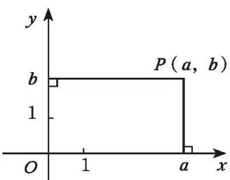
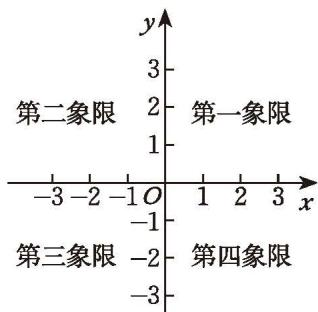

图3-6

(2) 如图 3-6, 如果小亮和他的朋友位于天安门广场, 并用 (0, 0) 表示天安门广场的位置, 那么你能分别表示北京奥林匹克公园、卢沟桥的位置吗?

在平面内，两条互相垂直且有公共原点的数轴组成平面直角坐标系（rectangular plane coordinates system）。通常，两条数轴分别置于水平位置与竖直位置，取向右与向上的方向分别为两条数轴的正方向。水平的数轴称为 $x$ 轴或横轴，竖直的数轴称为 $y$ 轴或纵轴， $x$ 轴和 $y$ 轴统称坐标轴，它们的公共原点 $O$ 称为平面直角坐标系的原点。

建立了平面直角坐标系，平面内的点就可以用一组有序实数对来表示了。

如图 3-7, 对于平面内任意一点 $P$ , 过点 $P$ 分别向 $x$ 轴、 $y$ 轴作垂线, 垂足在 $x$ 轴、 $y$ 轴上对应的数 $a$ , $b$ 分别称为点 $P$ 的横坐标、纵坐标, 有序实数对 $(a, b)$ 称为点 $P$ 的坐标。

图3-7

图3-8

如图 3-8，在平面直角坐标系中，两条坐标轴将坐标平面分成了四部分。右上方的部分称为第一象限，其他三部分按逆时针方向依次称为第二象限、第三象限和第四象限。坐标轴上的点不在任何一个象限内。
