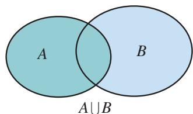

# 并集

## 知识讲解

一般地，由所有属于集合 A 或属于集合 B 的元素组成的集合，称为集合 A 与 B 的并集（union set），记作 $A \cup B$ （读作 “A 并 B”），即

  
图1.3-1

$$
A \bigcup B = \{x   |   x \in A  ,   \text {或}   x \in B \}  ,
$$

可用 Venn 图（图 1.3-1）表示.

## 先修知识

- [集合与元素](%E9%9B%86%E5%90%88%E4%B8%8E%E5%85%83%E7%B4%A0--000001.md)

## 本节例题与练习

- [习题 1.3 复习巩固 第1题](../%E4%B9%A0%E9%A2%98/Q9858780747002797076.md)
- [习题 1.3 复习巩固 第2题](../%E4%B9%A0%E9%A2%98/Q3257633990235354867.md)
- [习题 1.3 复习巩固 第3题](../%E4%B9%A0%E9%A2%98/Q11114887213782043897.md)
- [习题 1.3 拓广探索 第6题](../%E4%B9%A0%E9%A2%98/Q15389266487796158583.md)
- [习题 1.3 综合运用 第4题](../%E4%B9%A0%E9%A2%98/Q815696806787099632.md)
- [习题 1.3 综合运用 第5题](../%E4%B9%A0%E9%A2%98/Q12246699714315112642.md)
- [例 1 设 $A=\{4, 5, 6,](../%E4%B9%A0%E9%A2%98/Q18022349803527100922.md)
- [例 2 设集合 $A=\{x \mid](../%E4%B9%A0%E9%A2%98/Q13439021260984025191.md)
- [用集合交集表示两直线的位置关系](../%E4%B9%A0%E9%A2%98/Q2366494420248208610.md)
- [练习 1](../%E4%B9%A0%E9%A2%98/Q106458258324307532.md)
- [练习 1](../%E4%B9%A0%E9%A2%98/Q1519376102022073980.md)
- [练习 2](../%E4%B9%A0%E9%A2%98/Q3675930772252412091.md)
- [练习 2](../%E4%B9%A0%E9%A2%98/Q8482049777736973660.md)
- [练习 3](../%E4%B9%A0%E9%A2%98/Q2412345305978008943.md)
- [练习 3](../%E4%B9%A0%E9%A2%98/Q5217574665500416421.md)
- [补集例5](../%E4%B9%A0%E9%A2%98/Q7849389205387981840.md)
- [集合交集：参加两项比赛的同学](../%E4%B9%A0%E9%A2%98/Q8517533835493572378.md)
- [集合运算例6](../%E4%B9%A0%E9%A2%98/Q4308000667810319524.md)
- [集合运算练习](../%E4%B9%A0%E9%A2%98/Q5812455193431151339.md)

## 所属组织

- [1.3 集合的基本运算](../%E7%9F%A5%E8%AF%86%E4%B8%B2%E8%81%94/%E4%BA%BA%E6%95%99A-%E5%BF%85%E4%BF%AE%E7%AC%AC%E4%B8%80%E5%86%8C/%E7%AC%AC%E4%B8%80%E7%AB%A0%20%E9%9B%86%E5%90%88%E4%B8%8E%E5%B8%B8%E7%94%A8%E9%80%BB%E8%BE%91%E7%94%A8%E8%AF%AD/1.3%20%E9%9B%86%E5%90%88%E7%9A%84%E5%9F%BA%E6%9C%AC%E8%BF%90%E7%AE%97/1.3%20%E9%9B%86%E5%90%88%E7%9A%84%E5%9F%BA%E6%9C%AC%E8%BF%90%E7%AE%97.md)

## 相关练习组织（范围关联）

- [1.3 集合的基本运算](../%E9%A2%98%E5%9E%8B/%E4%BA%BA%E6%95%99A-%E5%BF%85%E4%BF%AE%E7%AC%AC%E4%B8%80%E5%86%8C/%E7%AC%AC%E4%B8%80%E7%AB%A0%20%E9%9B%86%E5%90%88%E4%B8%8E%E5%B8%B8%E7%94%A8%E9%80%BB%E8%BE%91%E7%94%A8%E8%AF%AD/1.3%20%E9%9B%86%E5%90%88%E7%9A%84%E5%9F%BA%E6%9C%AC%E8%BF%90%E7%AE%97/1.3%20%E9%9B%86%E5%90%88%E7%9A%84%E5%9F%BA%E6%9C%AC%E8%BF%90%E7%AE%97.md)
