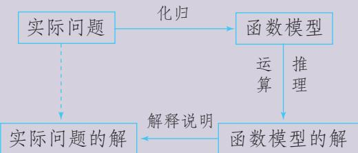

# 建立函数模型解决实际问题的基本过程

## 情境引入与思考

## 知识讲解

用函数建立数学模型解决实际问题的基本过程如下：

这一过程包括分析和理解实际问题的增长情况（是“对数增长”“直线上升”还是“指数爆炸”）；根据增长情况选择函数类型构建数学模型，将实际问题化归为数学问题；通过运算、推理求解函数模型；用得到的函数模型描述实际问题的变化规律，解决有关问题。在这一过程中，往往需要利用信息技术帮助画图、运算等。

## 本节例题与练习

- [例 3 利用马尔萨斯人口增长模型拟合与预测人口数据](../%E4%B9%A0%E9%A2%98/Q1122653245514569426.md)
- [例 4 利用碳14半衰期指数衰减模型推断良渚古城遗址年代](../%E4%B9%A0%E9%A2%98/Q18346701899659790355.md)
- [例 5 建立三种投资方案的函数模型并比较回报增长差异](../%E4%B9%A0%E9%A2%98/Q8475051470800765978.md)
- [例 6 根据散点图选择并建立企业销售利润奖励函数模型](../%E4%B9%A0%E9%A2%98/Q13319037361509374506.md)
- [练习 1](../%E4%B9%A0%E9%A2%98/Q12817307911998644099.md)
- [练习 1](../%E4%B9%A0%E9%A2%98/Q2732708590080153852.md)
- [练习 2](../%E4%B9%A0%E9%A2%98/Q8372325967442291012.md)
- [练习 2](../%E4%B9%A0%E9%A2%98/Q14455815838837709419.md)
- [练习 3](../%E4%B9%A0%E9%A2%98/Q7408267528046913050.md)

## 所属组织

- [4.5.3 函数模型的应用](../%E7%9F%A5%E8%AF%86%E4%B8%B2%E8%81%94/%E4%BA%BA%E6%95%99A-%E5%BF%85%E4%BF%AE%E7%AC%AC%E4%B8%80%E5%86%8C/%E7%AC%AC%E5%9B%9B%E7%AB%A0%20%E6%8C%87%E6%95%B0%E5%87%BD%E6%95%B0%E4%B8%8E%E5%AF%B9%E6%95%B0%E5%87%BD%E6%95%B0/4.5%20%E5%87%BD%E6%95%B0%E7%9A%84%E5%BA%94%E7%94%A8%28%E4%BA%8C%29/4.5.3%20%E5%87%BD%E6%95%B0%E6%A8%A1%E5%9E%8B%E7%9A%84%E5%BA%94%E7%94%A8.md)

## 相关练习组织（范围关联）

- [4.5.3 函数模型的应用](../%E9%A2%98%E5%9E%8B/%E4%BA%BA%E6%95%99A-%E5%BF%85%E4%BF%AE%E7%AC%AC%E4%B8%80%E5%86%8C/%E7%AC%AC%E5%9B%9B%E7%AB%A0%20%E6%8C%87%E6%95%B0%E5%87%BD%E6%95%B0%E4%B8%8E%E5%AF%B9%E6%95%B0%E5%87%BD%E6%95%B0/4.5%20%E5%87%BD%E6%95%B0%E7%9A%84%E5%BA%94%E7%94%A8%28%E4%BA%8C%29/4.5.3%20%E5%87%BD%E6%95%B0%E6%A8%A1%E5%9E%8B%E7%9A%84%E5%BA%94%E7%94%A8.md)
