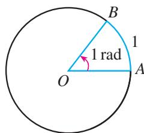

# 弧度制

## 情境引入与思考

## 知识讲解

我们规定：长度等于半径长的圆弧所对的圆心角叫做1弧度（radian）的角，弧度单位用符号rad表示，读作弧度.

我们把半径为 1 的圆叫做单位圆. 如图 5.1-11, 在单位圆 $O$ 中, $\widehat{AB}$ 的长等于 1, $\angle AOB$ 就是 1 弧度的角.

根据上述规定，在半径为 $r$ 的圆中，弧长为 $l$ 的弧所对的圆心角为 $\alpha$ rad，那么

  
图5.1-11

$$
| \alpha | = \frac {l}{r}.
$$

其中， $\alpha$ 的正负由角 $\alpha$ 的终边的旋转方向决定，即逆时针旋转为正，顺时针旋转为负。当角的终边旋转一周后继续旋转，就可以得到弧度数大于 $2\pi$ 或小于 $-2\pi$ 的角。这样就可以得到弧度为任意大小的角。

一般地，正角的弧度数是一个正数，负角的弧度数是一个负数，零角的弧度数是0.

## 先修知识

- [任意角、正角与负角](%E4%BB%BB%E6%84%8F%E8%A7%92%E4%B8%8E%E6%AD%A3%E8%A7%92%E3%80%81%E8%B4%9F%E8%A7%92%E3%80%81%E9%9B%B6%E8%A7%92--000056.md)

## 后续知识

- [任意角的三角函数](%E4%BB%BB%E6%84%8F%E8%A7%92%E7%9A%84%E4%B8%89%E8%A7%92%E5%87%BD%E6%95%B0--000062.md)
- [角度与弧度的换算](%E8%A7%92%E5%BA%A6%E4%B8%8E%E5%BC%A7%E5%BA%A6%E7%9A%84%E6%8D%A2%E7%AE%97--000061.md)

## 本节例题与练习

- [例 4 按照下列要求](../%E4%B9%A0%E9%A2%98/Q4448708962474160774.md)
- [例 5 将 3.14 rad 换算成角](../%E4%B9%A0%E9%A2%98/Q1750674033522778633.md)
- [例 6 利用弧度制证明下列关于扇形的公](../%E4%B9%A0%E9%A2%98/Q9971564701130730511.md)
- [练习 1](../%E4%B9%A0%E9%A2%98/Q3601577242818210590.md)
- [练习 2](../%E4%B9%A0%E9%A2%98/Q15000786237585604598.md)
- [练习 3](../%E4%B9%A0%E9%A2%98/Q4781710294414593486.md)
- [练习 4](../%E4%B9%A0%E9%A2%98/Q5299903387915429798.md)
- [练习 5](../%E4%B9%A0%E9%A2%98/Q14575497627866648079.md)
- [练习 6](../%E4%B9%A0%E9%A2%98/Q6212214605447673139.md)

## 所属组织

- [5.1.2 弧度制](../%E7%9F%A5%E8%AF%86%E4%B8%B2%E8%81%94/%E4%BA%BA%E6%95%99A-%E5%BF%85%E4%BF%AE%E7%AC%AC%E4%B8%80%E5%86%8C/%E7%AC%AC%E4%BA%94%E7%AB%A0%20%E4%B8%89%E8%A7%92%E5%87%BD%E6%95%B0/5.1%20%E4%BB%BB%E6%84%8F%E8%A7%92%E5%92%8C%E5%BC%A7%E5%BA%A6%E5%88%B6/5.1.2%20%E5%BC%A7%E5%BA%A6%E5%88%B6.md)

## 相关练习组织（范围关联）

- [5.1.2 弧度制](../%E9%A2%98%E5%9E%8B/%E4%BA%BA%E6%95%99A-%E5%BF%85%E4%BF%AE%E7%AC%AC%E4%B8%80%E5%86%8C/%E7%AC%AC%E4%BA%94%E7%AB%A0%20%E4%B8%89%E8%A7%92%E5%87%BD%E6%95%B0/5.1%20%E4%BB%BB%E6%84%8F%E8%A7%92%E5%92%8C%E5%BC%A7%E5%BA%A6%E5%88%B6/5.1.2%20%E5%BC%A7%E5%BA%A6%E5%88%B6.md)
