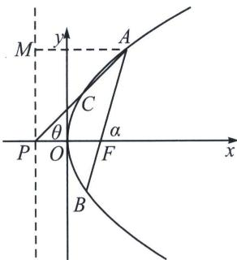

# 抛物线焦点弦与准线的斜率关系

## 2026版高中《mst老唐说题》圆锥曲线专题（数学）

## 二、焦准斜率关系与转化

如图所示，以抛物线 $y^{2}=2px$ (p>0) 为例，AB 是焦点弦，AC 过准线与 x 轴交点 $P\left(-\frac{p}{2},0\right)$ ，设 $\angle AFx=\alpha$ ， $\angle APF=\theta$ ，则一定有：① $y_{B}+y_{C}=0$ ；② $\sin\alpha=\tan\theta$ ，③ $\frac{1}{\tan^{2}\theta}-\frac{1}{\tan^{2}\alpha}=1$ ；

$$
\left\{ \begin{array}{l} y ^ {2} = 2 p x \\ x = t _ {1} y + \frac {p}{2} \end{array} \Rightarrow y ^ {2} - 2 p t _ {1} y - p ^ {2} = 0 \Rightarrow y _ {A} y _ {B} = - p ^ {2}, \left\{ \begin{array}{l} y ^ {2} = 2 p x \\ x = t _ {2} y - \frac {p}{2} \end{array} \Rightarrow y ^ {2} - 2 p t _ {2} y + p ^ {2} = 0 \Rightarrow y _ {A} y _ {C} = p ^ {2}, \right. \right.
$$

所以 $\frac{y_A y_B}{y_A y_C} = -1$ ，即 $y_B + y_C = 0$ ； $\sin \alpha = \frac{|y_A|}{|AF|} = \frac{|MP|}{|AM|} = \tan \theta$ ， $\frac{1}{\tan^2\theta} - \frac{1}{\tan^2\alpha} = \frac{1}{\sin^2\alpha} - \frac{1 - \sin^2\alpha}{\sin^2\alpha} = 1$ ；

## 相关原子

- [抛物线的定义与标准方程](%E6%8A%9B%E7%89%A9%E7%BA%BF%E7%9A%84%E5%AE%9A%E4%B9%89%E4%B8%8E%E6%A0%87%E5%87%86%E6%96%B9%E7%A8%8B.md)
- [直线的倾斜角与斜率](%E7%9B%B4%E7%BA%BF%E7%9A%84%E5%80%BE%E6%96%9C%E8%A7%92%E4%B8%8E%E6%96%9C%E7%8E%87.md)

## 所属组织

- [二、焦准斜率关系与转化](../%E9%A2%98%E5%9E%8B/%E6%8C%89%E9%A2%98%E5%9E%8B%E5%88%86%E7%B1%BB/%E5%9C%86%E9%94%A5%E6%9B%B2%E7%BA%BF/%E5%9C%86%E9%94%A5%E6%9B%B2%E7%BA%BF%E5%9B%9B%E5%AE%9A%E4%B9%89/%E7%AC%AC%E4%BA%94%E8%8A%82_%E6%8A%9B%E7%89%A9%E7%BA%BF%E7%9A%84%E7%84%A6%E5%87%86%E7%BF%BB%E8%AF%91/%E4%BA%8C_%E7%84%A6%E5%87%86%E6%96%9C%E7%8E%87%E5%85%B3%E7%B3%BB%E4%B8%8E%E8%BD%AC%E5%8C%96.md)

## 题型训练 · 2026版高中《mst老唐说题》圆锥曲线专题（数学）

### 圆锥曲线四定义 / 第五节 抛物线的焦准翻译

> [!example]- 二、焦准斜率关系与转化
> 
