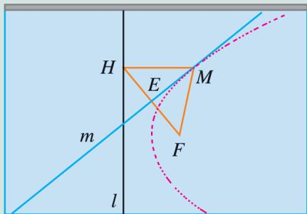
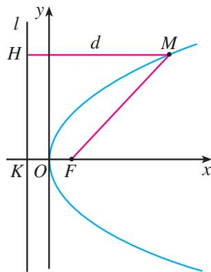

如图 3.3-1，设 $F$ 是定点， $l$ 是不经过点 $F$ 的定直线， $H$ 是直线 $l$ 上任意一点，过点 $H$ 作 $MH \perp l$ ，线段 $FH$ 的垂直平分线 $m$ 交 $MH$ 于点 $M$ 。在点 $M$ 随着点 $H$ 运动的过程中，始终有 $\left|MF\right|=\left|MH\right|$ ，即点 $M$ 与定点 $F$ 的距离等于它到定直线 $l$ 的距离，点 $M$ 的轨迹形状与二次函数的图象相似。

  
图3.3-1

我们把平面内与一个定点 F 和一条定直线 l（l 不经过点 F）的距离相等的点的轨迹叫做抛物线（parabola）。点 F 叫做抛物线的焦点，直线 l 叫做抛物线的准线。

下面根据抛物线的几何特征，建立适当的坐标系，推导抛物线的标准方程。如图3.3-2，我们取经过点 $F$ 且垂直于直线 $l$ 的直线为 $x$ 轴，垂足为 $K$ ，并使原点与线段 $KF$ 的中点重合，建立平面直角坐标系 $Oxy$ 。设 $\left|KF\right| = p(p > 0)$ ，那么焦点 $F$ 的坐标为 $\left(\frac{p}{2}, 0\right)$ ，准线 $l$ 的方程为 $x = -\frac{p}{2}$ 。

设 $M(x, y)$ 是抛物线上任意一点，点 $M$ 到准线 $l$ 的距离为 $d$ 。由抛物线的定义，抛物线是点的集合

$$
P = \{M \mid | M F | = d \}.
$$

因为 $|MF| = \sqrt{\left(x - \frac{p}{2}\right)^2 + y^2}$ ， $d = \left|x + \frac{p}{2}\right|$ ，

所以

$$
\sqrt {\left(x - \frac {p}{2}\right) ^ {2} + y ^ {2}} = \left| x + \frac {p}{2} \right|.
$$

将上式两边平方并化简，得

  
图3.3-2

$$
y ^ {2} = 2 p x (p > 0).\tag{①}
$$

从上述过程可以看到，抛物线上任意一点的坐标（x，y）都是方程①的解，以方程①的解为坐标的点（x，y）与抛物线的焦点 $F\left(\frac{p}{2},0\right)$ 的距离和它到准线 $x=-\frac{p}{2}$ 的距离相等，即以方程①的解为坐标的点都在抛物线上．我们把方程①叫做抛物线的标准方程.它表示焦点在x轴正半轴上，焦点是 $F\left(\frac{p}{2},0\right)$ ，准线是 $x=-\frac{p}{2}$ 的抛物线.
