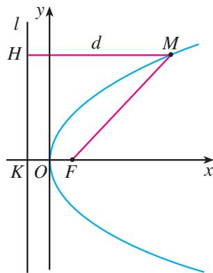

根据抛物线的几何特征，如图3.3-2，我们取经过点 $F$ 且垂直于直线 $l$ 的直线为 $x$ 轴，垂足为 $K$ ，并使原点与线段 $KF$ 的中点重合，建立平面直角坐标系 $Oxy$ 。设 $\left|KF\right| = p(p > 0)$ ，那么焦点 $F$ 的坐标为 $\left(\frac{p}{2}, 0\right)$ ，准线 $l$ 的方程为 $x = -\frac{p}{2}$

设 $M(x, y)$ 是抛物线上任意一点，点 $M$ 到准线 $l$ 的距离为 $d$ 。由抛物线的定义，130 第三章 圆锥曲线的方程

抛物线是点的集合

$$
P = \{M | | M F | = d \}.
$$

因为 $|MF| = \sqrt{\left(x - \frac{p}{2}\right)^2 + y^2}$ ， $d = \left|x + \frac{p}{2}\right|$ ，

所以

$$
\sqrt {\left(x - \frac {p}{2}\right) ^ {2} + y ^ {2}} = \left| x + \frac {p}{2} \right|.
$$

将上式两边平方并化简，得

  
图3.3-2

$$
y ^ {2} = 2 p x (p > 0).\tag{①}
$$

以 $-y$ 代 $y$ ，方程①不变，所以抛物线关于 $x$ 轴对称。我们把抛物线的对称轴叫做抛物线的轴。
