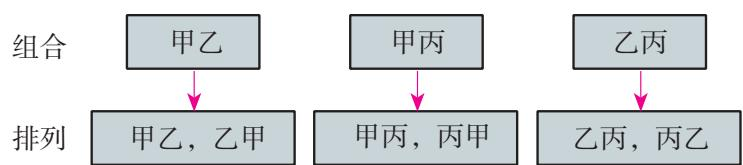

# 排列与组合的联系和区别

## 高中选择性必修 第三册·人教A版数学

思考

你能说一说排列与组合之间的联系与区别吗？

从排列与组合的定义可以知道，两者都是从 $n$ 个不同元素中取出 $m (m \leqslant n)$ 个元素，这是它们的共同点。但排列与元素的顺序有关，而组合与元素的顺序无关。只有元素相同且顺序也相同的两个排列才是相同的；而两个组合只要元素相同，不论元素的顺序如何，都是相同的。例如，在上述探究问题中，“甲乙”与“乙甲”的元素完全相同，但元素的排列顺序不同，因此它们是相同的组合，不同的排列。这样，以“元素相同”为标准分类，就可以建立起排列和组合之间的对应关系，如图6.2-7所示。

  
图6.2-7

由此，6.2.1节问题1的6个排列可以分成每组有2个不同排列的3个组，也就是上面探究问题的3个组合.
