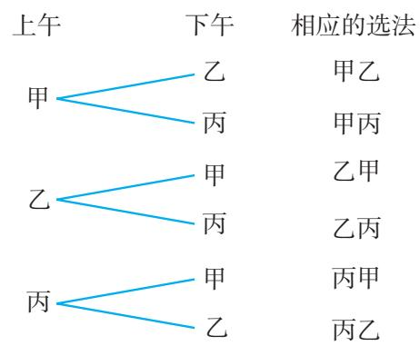
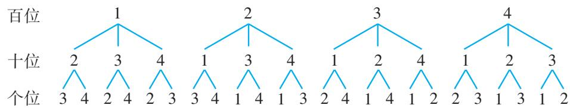

# 排列的概念与实际背景

## 高中选择性必修 第三册·人教A版数学

问题 1 从甲、乙、丙 3 名同学中选出 2 名参加一项活动，其中 1 名同学参加上午的活动，另 1 名同学参加下午的活动，有几种不同的选法？

此时，要完成的一件事是“选出2名同学参加活动，1名同学参加上午的活动，另1名同学参加下午的活动”，可以分两个步骤：

第 1 步，确定参加上午活动的同学，从 3 人中任选 1 人，有 3 种选法；

第 2 步，确定参加下午活动的同学，当参加上午活动的同学确定后，参加下午活动的同学只能从剩下的 2 人中去选，有 2 种选法.

根据分步乘法计数原理，不同的选法种数为

$$
3 \times 2 = 6.
$$

  
图6.2-1

这 6 种不同的选法如图 6.2-1 所示.

如果把上面问题中被取出的对象叫做元素，那么问题可叙述为：

从 3 个不同的元素 a, b, c 中任意取出 2 个，并按一定的顺序排成一列，共有多少种不同的排列方法？

所有不同的排列是

$$
a b, a c, b a, b c, c a, c b,
$$

问题1中的“顺序”是什么？

不同的排列方法种数为

$$
3 \times 2 = 6.
$$

问题2 从1，2，3，4这4个数字中，每次取出3个排成一个三位数，共可得到多少个不同的三位数？

显然，从4个数字中，每次取出3个，按“百位、十位、个位”的顺序排成一列，就得到一个三位数。因此有多少种不同的排列方法就有多少个不同的三位数。可以分三个步

第六章 计数原理

骤来解决这个问题：

第 1 步，确定百位上的数字，从 1，2，3，4 这 4 个数字中任取 1 个，有 4 种方法；

第 2 步，确定十位上的数字，当百位上的数字确定后，十位上的数字只能从余下的 3 个数字中去取，有 3 种方法；

第 3 步，确定个位上的数字，当百位、十位上的数字确定后，个位的数字只能从余下的 2 个数字中去取，有 2 种方法.

根据分步乘法计数原理，从 1，2，3，4 这 4 个不同的数字中，每次取出 3 个数字，按 “百位、十位、个位” 的顺序排成一列，不同的排法种数为

$$
4 \times 3 \times 2 = 2 4.
$$

因而共可得到 24 个不同的三位数，如图 6.2-2 所示.

  
图6.2-2

由此可写出所有的三位数：

$$
\begin{array}{l} 1 2 3, \quad 1 2 4, \quad 1 3 2, \quad 1 3 4, \quad 1 4 2, \quad 1 4 3, \end{array}
$$

$$
\begin{array}{l} 2 1 3, 2 1 4, 2 3 1, 2 3 4, 2 4 1, 2 4 3, \end{array}
$$

$$
3 1 2, 3 1 4, 3 2 1, 3 2 4, 3 4 1, 3 4 2,
$$

$$
4 1 2, 4 1 3, 4 2 1, 4 2 3, 4 3 1, 4 3 2.
$$

同样，问题2可以归结为：

从 4 个不同的元素 a, b, c, d 中任意取出 3 个，并按照一定的顺序排成一列，共有多少种不同的排列方法？

所有不同的排列是

$$
a b c, a b d, a c b, a c d, a d b, a d c,
$$

$$
b a c, b a d, b c a, b c d, b d a, b d c,
$$

$$
c a b, c a d, c b a, c b d, c d a, c d b,
$$

问题 2 中的 “顺序” 是什么？

$$
d a b, d a c, d b a, d b c, d c a, d c b.
$$

不同的排列方法种数为

$$
4 \times 3 \times 2 = 2 4.
$$

思考

上述问题1，2的共同特点是什么？你能将它们推广到一般情形吗？

问题 1 和问题 2 都是研究从一些不同元素中取出部分元素，并按照一定的顺序排成一列的方法数.

一般地，从 $n$ 个不同元素中取出 $m(m \leqslant n)$ 个元素，并按照一定的顺序排成一列，叫做从 $n$ 个不同元素中取出 $m$ 个元素的一个排列（arrangement）.

根据排列的定义，两个排列相同的充要条件是：两个排列的元素完全相同，且元素的排列顺序也相同。例如，在问题1中，“甲乙”与“甲丙”的元素不完全相同，它们是不同的排列；“甲乙”与“乙甲”虽然元素完全相同，但元素的排列顺序不同，它们也是不同的排列。又如，在问题2中，123与134的元素不完全相同，它们是不同的排列；123与132虽然元素完全相同，但元素的排列顺序不同，它们也是不同的排列。

## 后续知识

- [排列数公式及其推导](%E6%8E%92%E5%88%97%E6%95%B0%E5%85%AC%E5%BC%8F%E5%8F%8A%E5%85%B6%E6%8E%A8%E5%AF%BC.md)

## 本节例题与练习

- [例 1 某省中学生足球赛预选赛每组有](../%E4%B9%A0%E9%A2%98/Q070000001660.md)
- [例 2 （1）一张餐桌上有 5 盘不同](../%E4%B9%A0%E9%A2%98/Q070000001661.md)
- [练习 1](../%E4%B9%A0%E9%A2%98/Q070000001662.md)
- [练习 2](../%E4%B9%A0%E9%A2%98/Q070000001663.md)
- [练习 3](../%E4%B9%A0%E9%A2%98/Q070000001664.md)

## 所属组织

- [6.2.1 排列](../%E7%9F%A5%E8%AF%86%E4%B8%B2%E8%81%94/%E4%BA%BA%E6%95%99A-%E9%80%89%E6%8B%A9%E6%80%A7%E5%BF%85%E4%BF%AE%E7%AC%AC%E4%B8%89%E5%86%8C/%E7%AC%AC%E5%85%AD%E7%AB%A0%20%E8%AE%A1%E6%95%B0%E5%8E%9F%E7%90%86/6.2%20%E6%8E%92%E5%88%97%E4%B8%8E%E7%BB%84%E5%90%88/6.2.1%20%E6%8E%92%E5%88%97.md)

## 相关练习组织（范围关联）

- [6.2.1 排列](../%E9%A2%98%E5%9E%8B/%E6%8C%89%E7%AB%A0%E8%8A%82%E5%88%86%E7%B1%BB/%E4%BA%BA%E6%95%99A-%E9%80%89%E6%8B%A9%E6%80%A7%E5%BF%85%E4%BF%AE%E7%AC%AC%E4%B8%89%E5%86%8C/%E7%AC%AC%E5%85%AD%E7%AB%A0%20%E8%AE%A1%E6%95%B0%E5%8E%9F%E7%90%86/6.2%20%E6%8E%92%E5%88%97%E4%B8%8E%E7%BB%84%E5%90%88.md)
