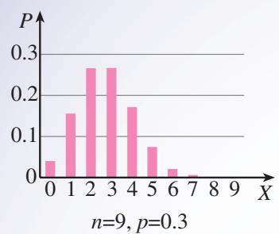
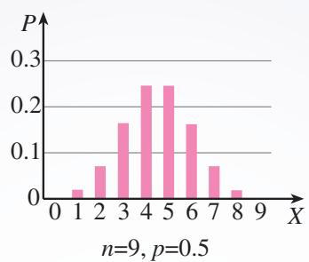
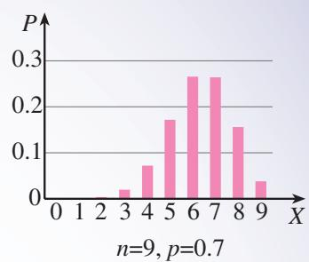
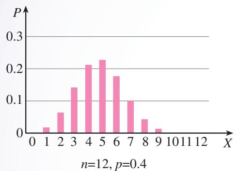
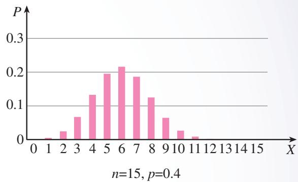

设随机变量 $X \sim B(n, p)$ ，则 $X$ 的分布列为

$$
P (X = k) = \mathrm{C} _ {n} ^ {k} p ^ {k} (1 - p) ^ {n - k}, k = 0, 1, \dots , n.
$$

对不同的 $n$ 和 $p$ 的值，绘制的概率分布图如图1所示.

  
(1)

  
(2)

  
(3)

  
(4)

  
图1  
(5)

观察图形，类比函数性质的研究，你能发现二项分布的哪些性质？提出你的猜想.

记 $p_k = P(X = k)$ ，观察图形我们发现：当 $k$ 由0增大到 $n$ 时， $p_k$ 先增后减，在某一个(或两个) $k$ 值处达到最大。二项分布当 $p = 0.5$ 时是对称的，当 $p < 0.5$ 时向左偏倚，当 $p > 0.5$ 时向右偏倚。

下面，我们利用分布列的表达式来研究 $p_k$ 的增减变化及最大值.

$$
\begin{array}{r l} \frac {p _ {k}}{p _ {k - 1}} & = \frac {\mathrm{C} _ {n} ^ {k} p ^ {k} (1 - p) ^ {n - k}}{\mathrm{C} _ {n} ^ {k - 1} p ^ {k - 1} (1 - p) ^ {n - k + 1}} = \frac {(n - k + 1) p}{k (1 - p)} \\ & = \frac {k (1 - p) + (n + 1) p - k}{k (1 - p)} = 1 + \frac {(n + 1) p - k}{k (1 - p)}. \end{array}
$$

当 $k < (n + 1)p$ 时， $p_k > p_{k - 1}$ ， $p_k$ 随 $k$ 值的增加而增加；当 $k > (n + 1)p$ 时， $p_k < p_{k - 1}$ ， $p_k$ 随 $k$ 值的增加而减小.

如果 $(n + 1)p$ 为正整数，当 $k = (n + 1)p$ 时， $p_k = p_{k - 1}$ ，此时这两项概率均为最大值。如果 $(n + 1)p$ 为非整数，而 $k$ 取 $(n + 1)p$ 的整数部分，则 $p_k$ 是唯一的最大值。

对你发现的二项分布的其他性质，你能给出证明吗？
