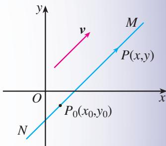

# 探究与发现 方向向量与直线的参数方程

## 高中选择性必修 第一册·人教A版数学

除了直线的点斜式、斜截式、两点式、截距式、一般式方程，还有一种形式的直线方程与向量有紧密的联系，它由一个定点和这条直线的方向向量唯一确定，与直线的点斜式方程本质上是一致的.

如图1，设直线 $l$ 经过点 $P_{0}(x_{0},y_{0})$ ， $\pmb {v} = (m,$ $n)$ 是它的一个方向向量， $P(x,y)$ 是直线 $l$ 上的任意一点，则向量 $\overrightarrow{P_0P}$ 与 $\pmb{v}$ 共线．根据向量共线的充要条件，存在唯一的实数 $t$ ，使 $\overrightarrow{P_0P} = tv$ ，即 $(x-$ $x_0,y - y_0) = t(m,n)$ ，所以

$$
\left\{ \begin{array}{l} x = x _ {0} + m t, \\ y = y _ {0} + n t. \end{array} \right.\tag{①}
$$

图1

在①中，实数 t 是对应点 P 的参变数，简称参数。由上可知，对于直线 l 上的任意一点 $P(x, y)$ ，存在唯一实数 t 使①成立；反之，对于参数 t 的每一个确定的值，由①可以确定直线 l 上的一个点 $P(x, y)$ 。我们把①称为直线的参数方程。

从运动学角度看， $\overrightarrow{P_0P} = tv (t > 0)$ 可以看成质点 $P$ 从点 $P_0$ 出发，以速度 $\mathbf{v} = (m, n)$ 作匀速直线运动，经过时间 $t$ 后的位移，因此，质点 $P$ 的运动轨迹是射线 $P_0M$ 。类似地，你能刻画射线 $P_0N$ 吗？由以上讨论，你能说说方程①的运动学意义吗？

如果直线 l 与坐标轴不垂直，那么 $mn \neq 0$ ，由①可得

$$
\frac {x - x _ {0}}{m} = t, \frac {y - y _ {0}}{n} = t,
$$

消去参数 $t$ ，得

$$
\frac {x - x _ {0}}{m} = \frac {y - y _ {0}}{n},
$$

即

$$
y - y _ {0} = \frac {n}{m} (x - x _ {0}),
$$

这样就得到直线 l 的点斜式方程.

从另外一个角度思考，因为直线 $l$ 经过点 $P_{0}(x_{0},y_{0})$ ，且它的一个方向向量为 $\pmb {v} = (m,n)$ ，所以直线 $l$ 的斜率 $k = \frac{n}{m}$ ，所以直线 $l$ 的方程为

$$
y - y _ {0} = \frac {n}{m} (x - x _ {0}).
$$
