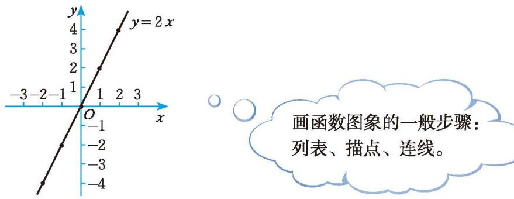

# 描点法画函数图象的基本步骤与正比例函数 y=2x 图象示范

## 北师大版初中数学·八年级上册

画正比例函数 y=2x 图象的基本步骤如下。

列表:

<table><tr><td>x</td><td>...</td><td>-2</td><td>-1</td><td>0</td><td>1</td><td>2</td><td>...</td></tr><tr><td>y</td><td>...</td><td>-4</td><td>-2</td><td>0</td><td>2</td><td>4</td><td>...</td></tr></table>

描点：以表中各组对应值作为点的坐标，在平面直角坐标系中描出相应的点。

连线：把这些点依次连接起来，得到 $y = 2x$ 的图象（如图4-5），它是一条直线。

图4-5
