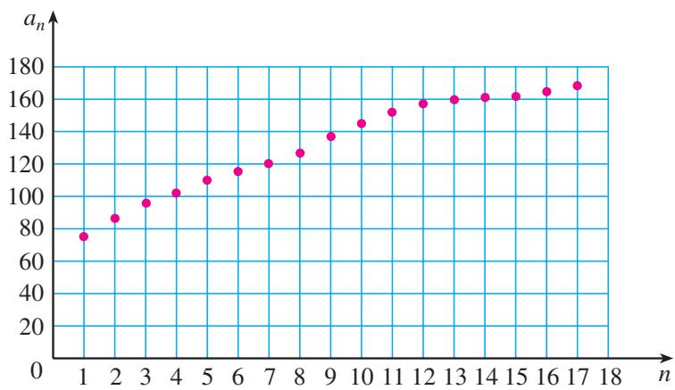

# 数列的表示与单调性

## 情境引入与思考

## 知识讲解

### 高中选择性必修 第二册·人教A版数学

与其他函数一样，数列也可以用表格和图象来表示．例如，数列①可以表示为表4.1-1.

表4.1-1

<table><tr><td>n</td><td>1</td><td>2</td><td>3</td><td>4</td><td>5</td><td>6</td><td>7</td><td>8</td><td>9</td><td>10</td><td>11</td><td>12</td><td>13</td><td>14</td><td>15</td><td>16</td><td>17</td></tr><tr><td>an</td><td>75</td><td>87</td><td>96</td><td>103</td><td>110</td><td>116</td><td>120</td><td>128</td><td>138</td><td>145</td><td>153</td><td>158</td><td>160</td><td>162</td><td>163</td><td>165</td><td>168</td></tr></table>

它的图象如图 4.1-1 所示.

  
图4.1-1

从表 4.1-1 和图 4.1-1 中，你能发现数列①中的项随序号的变化呈现出的特点吗？

与函数类似，我们可以定义数列的单调性。从第2项起，每一项都大于它的前一项的数列叫做递增数列；从第2项起，每一项都小于它的前一项的数列叫做递减数列。特别地，各项都相等的数列叫做常数列。

## 本节例题与练习

- [习题4.1 第1题](../%E4%B9%A0%E9%A2%98/Q070000001386.md)
- [习题4.1 第2题](../%E4%B9%A0%E9%A2%98/Q070000001387.md)
- [习题4.1 第3题](../%E4%B9%A0%E9%A2%98/Q070000001388.md)
- [习题4.1 第4题](../%E4%B9%A0%E9%A2%98/Q070000001389.md)
- [习题4.1 第5题](../%E4%B9%A0%E9%A2%98/Q070000001390.md)
- [习题4.1 第6题](../%E4%B9%A0%E9%A2%98/Q070000001391.md)
- [习题4.1 第7题](../%E4%B9%A0%E9%A2%98/Q070000001392.md)
- [判断数是否为数列的项](../%E4%B9%A0%E9%A2%98/Q070000001379.md)
- [由前几项猜想通项公式](../%E4%B9%A0%E9%A2%98/Q070000001374.md)
- [由递推公式求数列的项](../%E4%B9%A0%E9%A2%98/Q070000001381.md)
- [由通项公式写项并作图](../%E4%B9%A0%E9%A2%98/Q070000001373.md)
- [练习 1](../%E4%B9%A0%E9%A2%98/Q070000001375.md)
- [练习 1](../%E4%B9%A0%E9%A2%98/Q070000001382.md)
- [练习 2](../%E4%B9%A0%E9%A2%98/Q070000001376.md)
- [练习 2](../%E4%B9%A0%E9%A2%98/Q070000001383.md)
- [练习 3](../%E4%B9%A0%E9%A2%98/Q070000001377.md)
- [练习 3](../%E4%B9%A0%E9%A2%98/Q070000001384.md)
- [练习 4](../%E4%B9%A0%E9%A2%98/Q070000001385.md)
- [练习 4](../%E4%B9%A0%E9%A2%98/Q070000001378.md)
- [谢尔宾斯基三角形数列](../%E4%B9%A0%E9%A2%98/Q070000001380.md)

## 所属组织

- [4.1 数列的概念](../%E7%9F%A5%E8%AF%86%E4%B8%B2%E8%81%94/%E4%BA%BA%E6%95%99A-%E9%80%89%E6%8B%A9%E6%80%A7%E5%BF%85%E4%BF%AE%E7%AC%AC%E4%BA%8C%E5%86%8C/%E7%AC%AC%E5%9B%9B%E7%AB%A0%20%E6%95%B0%E5%88%97/4.1%20%E6%95%B0%E5%88%97%E7%9A%84%E6%A6%82%E5%BF%B5/4.1%20%E6%95%B0%E5%88%97%E7%9A%84%E6%A6%82%E5%BF%B5.md)

## 相关练习组织（范围关联）

- [4.1 数列的概念](../%E9%A2%98%E5%9E%8B/%E6%8C%89%E7%AB%A0%E8%8A%82%E5%88%86%E7%B1%BB/%E4%BA%BA%E6%95%99A-%E9%80%89%E6%8B%A9%E6%80%A7%E5%BF%85%E4%BF%AE%E7%AC%AC%E4%BA%8C%E5%86%8C/%E7%AC%AC%E5%9B%9B%E7%AB%A0%20%E6%95%B0%E5%88%97/4.1%20%E6%95%B0%E5%88%97%E7%9A%84%E6%A6%82%E5%BF%B5.md)
