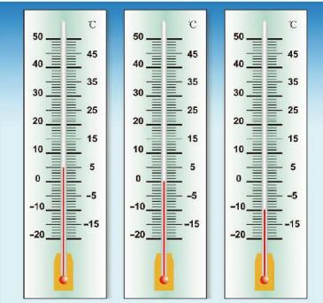
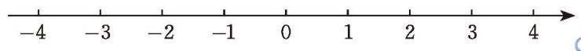

在一条水平直线上取一点（称为原点）表示0，选取某一长度作为单位长度，规定这条直线上向右的方向为正方向，那么相反方向就是负方向。原点右边的点可以表示正数，原点左边的点可以表示负数。这样，所有有理数就都可以用直线上的点表示了。

图2-3

像这样, 规定了原点 (origin)、单位长度 (unit length) 和正方向 (positive direction) 的直线称为数轴 (number line)。如图 2-4, 通常将数轴画成水平直线, 并选择向右的方向为正方向。

图2-4

像一个平放的温度计。

在这条数轴上，+3 可以用位于原点右边 3 个单位长度的点表示，-4 可以用位于原点左边 4 个单位长度的点表示。
