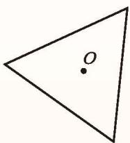
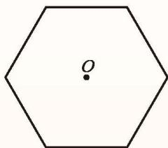
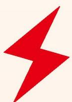

# 旋转对称图形的概念

## 北师大版初中数学·八年级下册

观察图 3-26 中的等边三角形，点 O 是它的角平分线的交点，将这个三角形绕着点 O 旋转 $120^{\circ}$ ，可以发现，旋转后的图形与旋转前的图形重合。

类似地, 观察图 3-27 中的正六边形, 点 $O$ 是它的内角平分线的交点, 将这个正六边形绕着点 $O$ 旋转 $60^{\circ}$ , 旋转后的图形也与旋转前的图形重合。

图3-26

图3-27

一般地, 如果把一个图形绕着某一点旋转一定角度 (小于 $360^{\circ}$ ) 后, 能与原来的图形重合, 那么这个图形叫作旋转对称图形, 这个点叫作它的对称中心。

等边三角形和正六边形都是旋转对称图形，图 3-28 所示的图形也都是旋转对称图形。

(1)

(2)

图3-28

(3)
