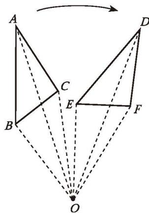

# 旋转的概念及对应元素

## 北师大版初中数学·八年级下册

在平面内，将一个图形绕一个定点按某个方向转动一个角度，这样的图形运动称为旋转（rotation），这个定点称为旋转中心，转动的角称为旋转角。旋转不改变图形的形状和大小。

如图 3-12, $\triangle ABC$ 绕点 $O$ 按顺时针方向旋转一个角度, 得到 $\triangle DEF$ , 点 $A, B, C$ 分别旋转到了点 $D, E, F$ 。点 $A$ 与点 $D$ 是一组对应点, 线段 $AB$ 与线段 $DE$ 是一组对应线段, $\angle BAC$ 与 $\angle EDF$ 是一组对应角。在这一旋转过程中, 点 $O$ 是旋转中心, $\angle AOD$ , $\angle BOE$ , $\angle COF$ 都是旋转角。

图3-12
