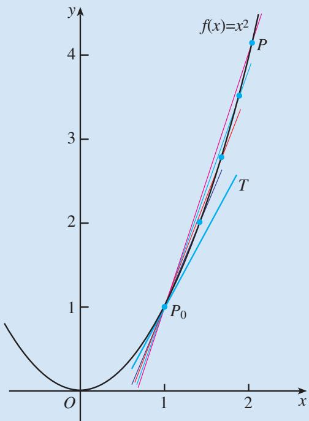
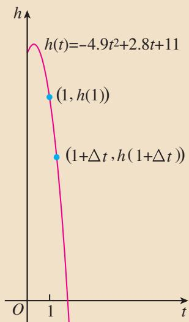

# 曲线切线、割线斜率与瞬时变化率

## 高中选择性必修 第二册·人教A版数学

与研究瞬时速度类似，为了研究抛物线 $f(x) = x^{2}$ 在点 $P_{0}(1,1)$ 处的切线，我们通常在点 $P_{0}(1,1)$ 的附近任取一点 $P(x,x^{2})$ ，考察抛物线 $f(x) = x^{2}$ 的割线 $P_{0}P$ 的变化情况.

观察

如图5.1-1，当点 $P(x, x^2)$ 沿着抛物线 $f(x) = x^2$ 趋近于点 $P_0(1, 1)$ 时，割线 $P_0P$ 有什么变化趋势？

  
图5.1-1

利用信息技术工具，演示图 5.1-1 中 $P_{0}P$ 的动态变化趋势.

我们发现，当点 $P$ 无限趋近于点 $P_{0}$ 时，割线 $P_{0}P$ 无限趋近于一个确定的位置，这个确定位置的直线 $P_{0}T$ 称为抛物线 $f(x) = x^{2}$ 在点 $P_{0}(1,1)$ 处的切线.

探究

我们知道，斜率是确定直线的一个要素．如何求抛物线 $f(x) = x^{2}$ 在点 $P_{0}(1,1)$ 处的切线 $P_{0}T$ 的斜率 $k_{0}$ 呢？

从上述切线的定义可见，抛物线 $f(x) = x^2$ 在点 $P_0(1, 1)$ 处的切线 $P_0T$ 的斜率与割线 $P_0P$ 的斜率有内在联系。记 $\Delta x = x - 1$ ，① 则点 $P$ 的坐标是 $(1 + \Delta x, (1 + \Delta x)^2)$ 。于是，割线 $P_0P$ 的斜率

① $\Delta x$ 可以是正值，也可以是负值，但不为0.

$$
k = \frac {f (x) - f (1)}{x - 1} = \frac {(1 + \Delta x) ^ {2} - 1}{(1 + \Delta x) - 1} = \Delta x + 2.
$$

我们可以用割线 $P_{0}P$ 的斜率 k 近似地表示切线 $P_{0}T$ 的斜率 $k_{0}$ ，并且可以通过不断缩短横坐标间隔 $\left|\Delta x\right|$ 来提高近似表示的精确度，得到如下表格（表 5.1-2）.

表5.1-2

<table><tr><td colspan="2"> $\Delta x<0$ </td><td colspan="2"> $\Delta x>0$ </td></tr><tr><td> $\Delta x$ </td><td> $k=\Delta x+2$ </td><td> $\Delta x$ </td><td> $k=\Delta x+2$ </td></tr><tr><td>-0.01</td><td>1.99</td><td>0.01</td><td>2.01</td></tr><tr><td>-0.001</td><td>1.999</td><td>0.001</td><td>2.001</td></tr><tr><td>-0.000 1</td><td>1.999 9</td><td>0.000 1</td><td>2.000 1</td></tr><tr><td>-0.000 01</td><td>1.999 99</td><td>0.000 01</td><td>2.000 01</td></tr><tr><td>-0.000 001</td><td>1.999 999</td><td>0.000 001</td><td>2.000 001</td></tr><tr><td colspan="2">......</td><td colspan="2">......</td></tr></table>

观察

利用计算工具计算更多割线 $P_0P$ 的斜率 $k$ 的值，当 $\Delta x$ 无限趋近于0时，割线 $P_0P$ 的斜率 $k$ 有什么变化趋势？

我们发现，当 $\Delta x$ 无限趋近于0时，即无论 $x$ 从小于1的一边，还是从大于1的一边无限趋近于1时，割线 $P_0P$ 的斜率 $k$ 都无限趋近于2.

事实上，由 $k = \frac{f(1 + \Delta x) - f(1)}{\Delta x} = \Delta x + 2$ 可以直接看出，当 $\Delta x$ 无限趋近于0时， $\Delta x + 2$ 无限趋近于2. 我们把2叫做“当 $\Delta x$ 无限趋近于0时， $k = \frac{f(1 + \Delta x) - f(1)}{\Delta x}$ 的极限”，记为

$$
\lim _ {\Delta x \rightarrow 0} \frac {f (1 + \Delta x) - f (1)}{\Delta x} = 2.
$$

从几何图形上看，当横坐标间隔 $|\Delta x|$ 无限变小时，点 $P$ 无限趋近于点 $P_{0}$ ，于是割线 $P_{0}P$ 无限趋近于点 $P_{0}$ 处的切线 $P_{0}T$ 。这时，割线 $P_{0}P$ 的斜率 $k$ 无限趋近于点 $P_{0}$ 处的切线 $P_{0}T$ 的斜率 $k_{0}$ 。因此，切线 $P_{0}T$ 的斜率 $k_{0} = 2$ 。

思考

观察问题 1 中的函数 $h(t) = -4.9t^{2} + 2.8t + 11$ 的图象(图 5.1-2)，平均速度

$$
\bar {v} = \frac {h (1 + \Delta t) - h (1)}{(1 + \Delta t) - 1}
$$

的几何意义是什么？瞬时速度 $v(1)$ 呢？

  
图5.1-2
