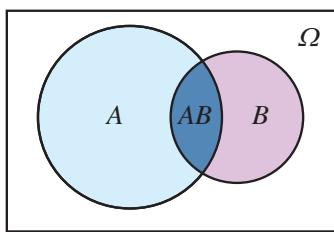

下面通过两个古典概型情境来引入条件概率的概念与计算公式。

**情形 1**：某个班级有 45 名学生，其中男生、女生的人数及团员的人数如表 7.1-1 所示。

表7.1-1  
单位：人

<table><tr><td>性别</td><td>团员</td><td>非团员</td><td>合计</td></tr><tr><td>男生</td><td>16</td><td>9</td><td>25</td></tr><tr><td>女生</td><td>14</td><td>6</td><td>20</td></tr><tr><td>合计</td><td>30</td><td>15</td><td>45</td></tr></table>

在班级里随机选择一人做代表，样本空间 $\Omega$ 包含 45 个等可能的样本点。用 $A$ 表示事件“选到团员”， $B$ 表示事件“选到男生”，根据表 7.1-1 中的数据可以得出， $n(\Omega)=45$ ， $n(A)=30$ ， $n(B)=25$ 。

（1）根据古典概型知识可知，选到男生的概率

$$
P (B) = \frac {n (B)}{n (\Omega)} = \frac {2 5}{4 5} = \frac {5}{9}.
$$

（2）“在选到团员的条件下，选到男生”的概率就是“在事件 $A$ 发生的条件下，事件 $B$ 发生”的概率，记为 $P(B|A)$ 。此时相当于以 $A$ 为样本空间来考虑事件 $B$ 发生的概率，而在新的样本空间中事件 $B$ 就是积事件 $AB$ ，包含的样本点数 $n(AB)=16$ 。根据古典概型知识可知，

$$
P (B \mid A) = \frac {n (A B)}{n (A)} = \frac {1 6}{3 0} = \frac {8}{1 5}.
$$

**情形 2**：假定生男孩和生女孩是等可能的，随机选择一个有两个小孩的家庭。观察两个小孩的性别，用 $b$ 表示男孩， $g$ 表示女孩，则样本空间 $\Omega = \{bb, bg, gb, gg\}$ ，且所有样本点是等可能的。用 $A$ 表示事件“选择的家庭中有女孩”， $B$ 表示事件“选择的家庭中两个小孩都是女孩”，则 $A = \{bg, gb, gg\}$ ， $B = \{gg\}$ 。

（1）根据古典概型知识可知，该家庭中两个小孩都是女孩的概率

$$
P (B) = \frac {n (B)}{n (\Omega)} = \frac {1}{4}.
$$

（2）“在选择的家庭有女孩的条件下，两个小孩都是女孩”的概率就是“在事件 $A$ 发生的条件下，事件 $B$ 发生”的概率，记为 $P(B|A)$ 。此时 $A$ 成为样本空间，事件 $B$ 就是积事件 $AB$ 。根据古典概型知识可知，

$$
P (B \mid A) = \frac {n (A B)}{n (A)} = \frac {1}{3}.
$$

在上面两个情形中，在事件 $A$ 发生的条件下，事件 $B$ 发生的概率都是

$$
P (B \mid A) = \frac {n (A B)}{n (A)}.
$$

这个结论对于一般的古典概型仍然成立。事实上，如图 7.1-1 所示，若已知事件 $A$ 发生，则 $A$ 成为样本空间。此时，事件 $B$ 发生的概率是 $AB$ 包含的样本点数与 $A$ 包含的样本点数的比值，即

$$
P (B \mid A) = \frac {n (A B)}{n (A)}.
$$

因为

$$
P (B \mid A) = \frac {n (A B)}{n (A)} = \frac {\frac {n (A B)}{n (\Omega)}}{\frac {n (A)}{n (\Omega)}} = \frac {P (A B)}{P (A)},
$$

  
图7.1-1

所以，在事件 $A$ 发生的条件下，事件 $B$ 发生的概率还可以通过 $\frac{P(AB)}{P(A)}$ 来计算.

一般地，设 $A$ ， $B$ 为两个随机事件，且 $P(A) > 0$ ，我们称

$$
P (B \mid A) = \frac {P (A B)}{P (A)}
$$

为在事件 $A$ 发生的条件下，事件 $B$ 发生的条件概率，简称条件概率（conditional probability）.
