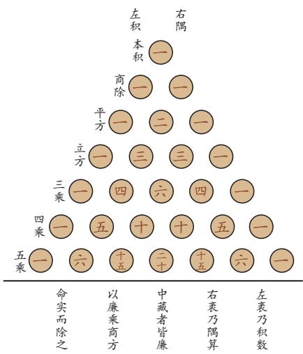

# 杨辉三角的历史与结构

## 高中选择性必修 第三册·人教A版数学

在探究 $(a + b)^n$ 的展开式的二项式系数性质时，我们曾把系数写成一张表（图1），借助它发现了系数的一些规律。事实上，在我国南宋数学家杨辉1261年所著的《详解九章算法》一书中，就已经出现了这个表。所不同的只是这里的表用阿拉伯数字表示，在那本书里是用汉字表示（图2）。我们称这个表为杨辉三角。

<table><tr><td> $(a+b)^{1}$ </td><td>1</td><td>1</td><td></td><td></td><td></td><td></td></tr><tr><td> $(a+b)^{2}$ </td><td>1</td><td>2</td><td>1</td><td></td><td></td><td></td></tr><tr><td> $(a+b)^{3}$ </td><td>1</td><td>3</td><td>3</td><td>1</td><td></td><td></td></tr><tr><td> $(a+b)^{4}$ </td><td>1</td><td>4</td><td>6</td><td>4</td><td>1</td><td></td></tr><tr><td> $(a+b)^{5}$ </td><td>1</td><td>5</td><td>10</td><td>10</td><td>5</td><td>1</td></tr><tr><td> $(a+b)^{6}$ </td><td>1</td><td>6</td><td>15</td><td>20</td><td>15</td><td>6</td></tr><tr><td>⋮</td><td></td><td></td><td>⋮</td><td></td><td></td><td></td></tr></table>

图1

  
图2

杨辉是我国古代数学史上一位著述丰富的数学家，著有《详解九章算法》《日用算法》和《杨辉算法》。在编写这些算书时，杨辉广泛引用古代数学典籍，使得我们能够了解许多已经失传的数学方法。杨辉在《详解九章算法》里指出，杨辉三角这种方法出于《释锁》 $^{①}$ 算书，且我国北宋数学家贾宪（约11世纪上半叶）曾用过。由此可以推断，我国发现这个表不晚于11世纪上半叶。在欧洲，这个表被认为是法国数学家帕斯卡（B. Pascal，1623—1662）首先发现的，他们把这个表叫做帕斯卡三角。这就是说，杨辉三角的

① “释锁”和开方有关。杨辉三角原名为“开方作法本源图”，也有人称它为“乘方求廉图”，在我国古代用来作为开方的工具。

发现要比欧洲早600年左右，由此可见我国古代数学的成就是非常值得中华民族自豪的。

杨辉三角本身包含了很多有趣的性质，利用这些性质，可以解决很多数学问题。下面让我们一起来探索吧！

## 所属组织

- [数学探究 杨辉三角的性质与应用](../%E7%9F%A5%E8%AF%86%E4%B8%B2%E8%81%94/%E4%BA%BA%E6%95%99A-%E9%80%89%E6%8B%A9%E6%80%A7%E5%BF%85%E4%BF%AE%E7%AC%AC%E4%B8%89%E5%86%8C/%E7%AC%AC%E5%85%AD%E7%AB%A0%20%E8%AE%A1%E6%95%B0%E5%8E%9F%E7%90%86/%E6%95%B0%E5%AD%A6%E6%8E%A2%E7%A9%B6%20%E6%9D%A8%E8%BE%89%E4%B8%89%E8%A7%92%E7%9A%84%E6%80%A7%E8%B4%A8%E4%B8%8E%E5%BA%94%E7%94%A8.md)

## 相关练习组织（范围关联）

- [第六章 计数原理](../%E9%A2%98%E5%9E%8B/%E6%8C%89%E7%AB%A0%E8%8A%82%E5%88%86%E7%B1%BB/%E4%BA%BA%E6%95%99A-%E9%80%89%E6%8B%A9%E6%80%A7%E5%BF%85%E4%BF%AE%E7%AC%AC%E4%B8%89%E5%86%8C/%E7%AC%AC%E5%85%AD%E7%AB%A0%20%E8%AE%A1%E6%95%B0%E5%8E%9F%E7%90%86/%E7%AC%AC%E5%85%AD%E7%AB%A0%20%E8%AE%A1%E6%95%B0%E5%8E%9F%E7%90%86.md)
