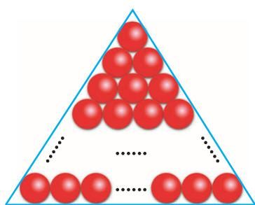

在我国古代，杨辉三角是解决很多数学问题的有力工具，像开方问题、数列问题等.

例如，开方古算题（出自杨辉《详解九章算法》）：

积一百三十三万六千三百三十六尺，问为三乘方几何.

在我国清中叶以前，称平方为自乘，立方为再自乘，四次方为三乘方．因此，这个问题相当于解方程 $x^4 = 1336336$

杨辉三角（图 2）中的五句话，前三句 “左袤乃积数，右袤乃隅算，中藏者皆廉” 分别说明了图中数字代表的意义，后两句 “以廉乘商方，命实而除之” 说明了如何应用各行系数进行开方.

你可以查阅相关书籍或上网搜索相关资料，探究一下开方算法的具体操作及其中蕴含的算法思想，感受我国古代数学的独特风格.

再如，数列古算题（出自杨辉《详解九章算法》）：

三角垛，下广，一面十二个，上尖，问计几何.

在我国古代，很多数学家研究数列的问题，并取得了辉煌的成就。就像通过研究“三角垛”这样的一类问题——垛积问题，发现了一系列数列的求和公式。上述三角垛问题一般化后，就相当于如下将圆球堆成三角垛的问题：

  
图5

底层是每边堆 n 个圆球的三角形（如图 5），向上逐层每边减少 1 个，顶层是 1 个，求总数.

利用杨辉三角，就可以解决以上问题，并获得每层圆球数所构成的数列的一般求和公式。你可以试一试。

除此之外，你还可以通过查阅相关书籍或上网搜索相关资料，从杨辉三角出发，一步步探究，拓展到更多类数列的问题.

以独立探究和小组合作相结合的方式开展探究活动。建议按如下步骤完成：

1. 小组集体讨论探究方案，确定研究思路.

2. 小组成员各自开展独立探究，并以专题作业的形式撰写研究报告.

3. 小组内进行交流讨论，完善研究成果，并形成一份小组研究报告.

4. 全班进行成果交流、评价.
