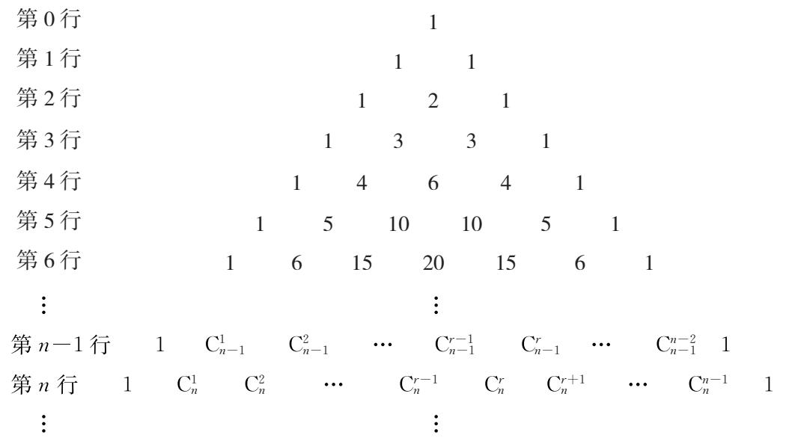
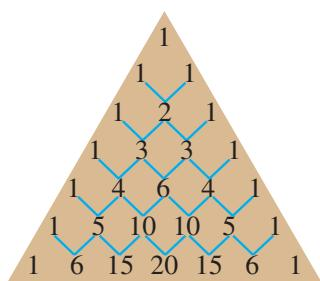

# 杨辉三角的性质

## 高中选择性必修 第三册·人教A版数学

1. 观察杨辉三角的结构，即杨辉三角中数字排列的规律，例如每一行、相邻两行、斜行等，画一画，连一连，算一算，写出你发现的结论.

例如：

（1）结合图 1 和图 2，可以发现，杨辉三角的第 n 行的第 r 个数可以表示为 $C_{n}^{r-1}$ ，第 n 行就是 $(a+b)^{n}$ 的展开式的二项式系数，如图 3 所示.

  
图3

（2）观察杨辉三角的相邻两行，可以发现，三角形的两个腰上的数都是1，其余的数都等于它肩上的两个数相加.

如图 4 所示， $2=1+1$ ， $3=1+2$ ， $4=1+3$ ， $6=3+3$ ，…一般地，有

$$
\mathrm{C} _ {n} ^ {r} = \mathrm{C} _ {n - 1} ^ {r - 1} + \mathrm{C} _ {n - 1} ^ {r}.\tag{①}
$$

2. 利用已学知识，尝试对所得结论进行证明.

图4

例如，对于①式，可按如下方式进行证明.

因为

$$
\begin{array}{r l} \mathrm{C} _ {n - 1} ^ {r - 1} + \mathrm{C} _ {n - 1} ^ {r} & = \frac {(n - 1) !}{(r - 1) ! (n - r) !} + \frac {(n - 1) !}{r ! (n - 1 - r) !} \\ & = \frac {(n - 1) !}{r ! (n - r) !} [ r + (n - r) ] \\ & = \frac {n !}{r ! (n - r) !}, \end{array}
$$

又

$$
\mathrm{C} _ {n} ^ {r} = \frac {n !}{r ! (n - r) !},
$$

所以

$$
\mathrm{C} _ {n} ^ {r} = \mathrm{C} _ {n - 1} ^ {r - 1} + \mathrm{C} _ {n - 1} ^ {r}.
$$

上式是杨辉三角最基本的性质，也是二项式系数和组合数的性质。 $^{①}$ 正因为杨辉三角中的数与开方、解方程，以及组合数学、概率论中的有关问题都有密切的关系，所以历代数学家从不同角度研究它的性质，例如帕斯卡在《论算术三角》一书中就给出了19条性质。你也来试一试吧，看能发现和证明多少性质！

①利用数学知识间的联系性，我们可以从不同角度研究这些性质。结合已有知识，对比一下不同角度发现和证明性质的过程，说一说自己的体会。
