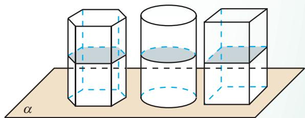
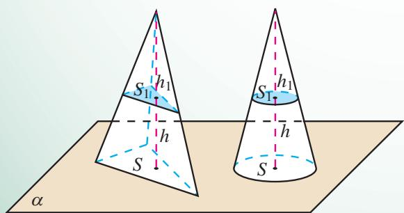
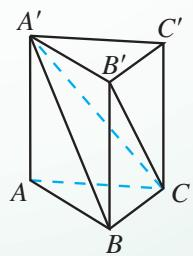
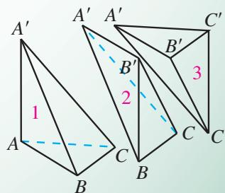

下面我们用祖暅原理推导柱体和锥体的体积公式.

设有底面积都等于 S，高都等于 h 的任意一个棱柱、一个圆柱和一个长方体，使它们的下底面在同一平面内（图3）。根据祖暅原理，可知它们的体积相等。由于长方体的体积等于它的底面积乘高，于是我们得到柱体的体积公式 $V_{柱体}=Sh.$

  
图3

其中 S 是柱体的底面积，h 是柱体的高.

设有底面积都等于 S，高都等于 h 的两个锥体（例如一个棱锥和一个圆锥），使它们的底面在同一平面内（图 4）。根据祖暅原理，可推导出它们的体积相等。这就是说，等底面积等高的两个锥体的体积相等。

  
图4

  
图5

如图5，设三棱柱 $ABC-A^{\prime}B^{\prime}C^{\prime}$ 的底面积（即△ABC的面积）为S，高（即点 $A^{\prime}$ 到平面ABC的距离）为h，则它的体积为Sh。沿平面 $A^{\prime}BC$ 和平面 $A^{\prime}B^{\prime}C$ ，将这个三棱柱分割为3个三棱锥。其中三棱锥1，2的底面积相等（ $S_{\triangle A^{\prime}AB}=S_{\triangle A^{\prime}B^{\prime}B}$ ），高也相等（点C到平面 $ABB^{\prime}A^{\prime}$ 的距离），三棱锥2，3也有相等的底面积（ $S_{\triangle B^{\prime}BC}=S_{\triangle B^{\prime}C^{\prime}C}$ ）和相等的高（点 $A^{\prime}$ 到平面 $BCC^{\prime}B^{\prime}$ 的距离）。因此，这3个三棱锥的体积相等，每个三棱锥的体积是 $\frac{1}{3}Sh$ 。

如果三棱锥 $A^{\prime} - ABC$ （即三棱锥1）以 $\triangle ABC$ 为底，那么它的底面积是 $S$ ，高是 $h$ ，而它的体积是 $\frac{1}{3} Sh$ 。这说明三棱锥的体积等于它的底面积乘高的积的三分之一。

事实上，对于一个任意的锥体，设它的底面积为 S，高为 h，那么它的体积应等于一个底面积为 S，高为 h 的三棱锥的体积，即这个锥体的体积为

$$
V _ {\text {锥体}} = \frac {1}{3} S h.
$$

这就是锥体的体积公式.

柱体和锥体是两种基本几何体，它们的体积公式有着广泛的应用.
