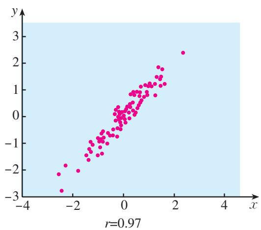
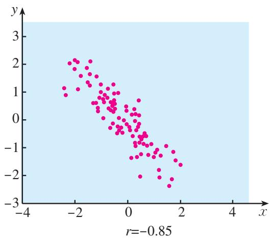
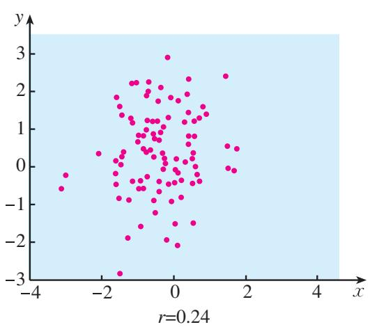
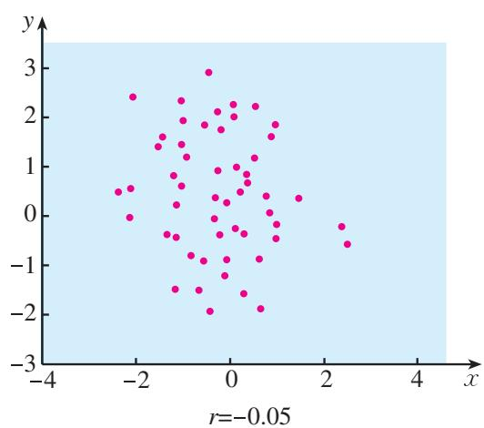

设成对样本数据 $(x_{1}, y_{1}), (x_{2}, y_{2}), \dots, (x_{n}, y_{n})$ 的均值分别为 $\overline{x}, \overline{y}$ ，标准差分别为 $s_{x}, s_{y}$ ，标准化后的 $n$ 维向量 $\boldsymbol{x}' = \left(\frac{x_{1}-\overline{x}}{s_{x}}, \dots, \frac{x_{n}-\overline{x}}{s_{x}}\right)$ 与 $\boldsymbol{y}' = \left(\frac{y_{1}-\overline{y}}{s_{y}}, \dots, \frac{y_{n}-\overline{y}}{s_{y}}\right)$ 的夹角为 $\theta$ ，则样本相关系数为 $r = \cos\theta = \frac{\sum_{i=1}^{n}(x_{i}-\overline{x})(y_{i}-\overline{y})}{\sqrt{\sum_{i=1}^{n}(x_{i}-\overline{x})^{2}}\sqrt{\sum_{i=1}^{n}(y_{i}-\overline{y})^{2}}}$ 。

当 $|r|=1$ 时， $r=\cos\theta$ 中的 $\theta=0$ 或 $\pi$ ，向量 $\boldsymbol{x}'$ 和 $\boldsymbol{y}'$ 共线。由向量的知识可知，存在实数 $\lambda$ ，使得 $\boldsymbol{y}'=\lambda \boldsymbol{x}'$ ，即

$$
\frac {y _ {i} - \overline {{y}}}{s _ {y}} = \lambda \frac {x _ {i} - \overline {{x}}}{s _ {x}}, \quad i = 1, 2, \dots , n.
$$

这表明成对样本数据 $(x_{i},y_{i})$ 都落在直线

$$
y - \overline {{y}} = \frac {\lambda s _ {y}}{s _ {x}} (x - \overline {{x}})
$$

上．这时，成对样本数据的两个分量之间满足一种线性关系.

由此可见，样本相关系数 $r$ 的取值范围为 $[-1, 1]$ . 样本相关系数 $r$ 的绝对值大小可以反映成对样本数据之间线性相关的程度：

样本相关系数 $r$ 有时也称样本线性相关系数， $|r|$ 刻画了样本点集中于某条直线的程度。当 $r=0$ 时，只表明成对样本数据间没有线性相关关系，但不排除它们之间有其他相关关系。

当 $|r|$ 越接近 1 时，成对样本数据的线性相关程度越强；

当 $|r|$ 越接近 0 时，成对样本数据的线性相关程度越弱.

图 8.1-5 是不同成对样本数据的散点图和相应的样本相关系数。图（1）中的散点有明显的从左下角到右上角沿直线分布的趋势，说明成对样本数据呈现出线性相关关系；样本相关系数 $r=0.97$ ，表明成对样本数据的正线性相关程度很强。图（2）中的散点有明显的从左上角到右下角沿直线分布的趋势，说明成对样本数据也呈现出线性相关关系；样本相关系数 $r = -0.85$ ，表明成对样本数据的负线性相关程度比较强。从样本相关系数来看，图（1）中成对样本数据的线性相关程度要比图（2）中强一些；图（3）和图（4）中的成对样本数据的线性相关程度很弱，其中图（4）中成对样本数据的线性相关程度极弱。

  
(1)

  
(2)

  
(3)

  
(4)  
图8.1-5

综上可知，两个随机变量的相关性可以通过成对样本数据进行分析，而样本相关系数 $r$ 可以反映两个随机变量之间的线性相关程度： $r$ 的符号反映了相关关系的正负性； $|r|$ 的大小反映了两个变量线性相关的程度，即散点集中于一条直线的程度.

在有限总体中，若要确切地了解两个变量之间相关关系的正负性及线性相关的程度，我们可以利用这两个变量取值的所有成对数据，通过样本相关系数公式计算出两个变量的相关系数。例如，要确切了解脂肪含量 $y$ 与年龄 $x$ 的线性相关程度，需要调查所有人的年龄及其脂肪含量，再将得到的成对数据代入相关系数公式，计算出相关系数。这个相关系数就能确切地反映变量之间的相关程度。

不过，在实际中，获得总体中所有的成对数据往往是不容易的。因此，我们还是要用样本估计总体的思想来解决问题。也就是说，我们先要通过抽样获取两个变量的一些成对样本数据，再计算出样本相关系数，通过样本相关系数去估计总体相关系数，从而了解两个变量之间的相关程度。对于简单随机样本而言，样本具有随机性，因此样本相关系数 $r$ 也具有随机性。一般地，样本容量越大，用样本相关系数估计两个变量的相关系数的效果越好。
