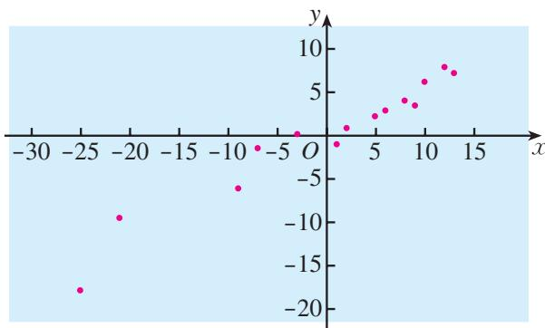
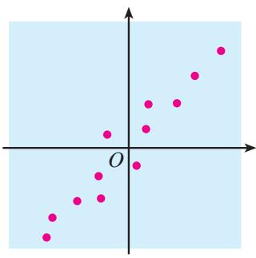
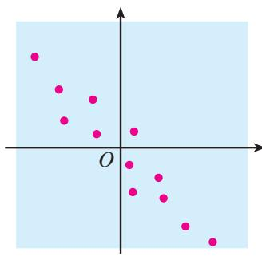

# 样本相关系数的构造与定义

## 高中选择性必修 第三册·人教A版数学

通过观察散点图中成对样本数据的分布规律，我们可以大致推断两个变量是否存在相关关系、是正相关还是负相关、是线性相关还是非线性相关等。散点图虽然直观，但无法确切地反映成对样本数据的相关程度，也就无法量化两个变量之间相关程度的大小。能否像引入均值、方差等数字特征对单个变量数据进行分析那样，引入一个适当的“数字特征”，对成对样本数据的相关程度进行定量分析呢？

对于变量 x 和变量 y，设经过随机抽样获得的成对样本数据为 $(x_{1}, y_{1})$ ， $(x_{2}, y_{2})$ ， $\cdots$ ， $(x_{n}, y_{n})$ ，其中 $x_{1}, x_{2}, \cdots, x_{n}$ 和 $y_{1}, y_{2}, \cdots, y_{n}$ 的均值分别为 $\overline{x}$ 和 $\overline{y}$ 。为了刻画每个变量的观测数据相对其均值的增减情况，将每个变量的观测数据减去其均值，得到成对数据为

$$
\left(x _ {1} - \bar {x}, y _ {1} - \bar {y}\right), \left(x _ {2} - \bar {x}, y _ {2} - \bar {y}\right), \dots , \left(x _ {n} - \bar {x}, y _ {n} - \bar {y}\right),
$$

并绘制散点图.

利用上述方法处理表 8.1-1 中的数据，得到图 8.1-3. 我们发现，这时的散点大多数分布在第一象限、第三象限，大多数散点的横、纵坐标同号。显然，这样的规律是由人体脂肪含量与年龄正相关所决定的。

  
图8.1-3

一般地，如果变量 $x$ 和 $y$ 正相关，那么关于均值平移后的大多数散点将分布在第一象限、第三象限，对应的成对数据同号的居多，如图8.1-4（1）所示；如果变量 $x$ 和 $y$ 负相关，那么关于均值平移后的大多数散点将分布在第二象限、第四象限，对应的成对数据异号的居多，如图8.1-4（2）所示.

  
(1)

  
(2)  
图8.1-4

思考

根据上述分析，你能利用正相关变量和负相关变量的成对样本数据平移后呈现的规律，构造一个度量成对样本数据是正相关还是负相关的数字特征吗？

从上述讨论得到启发，利用散点 $(x_{i}-\overline{x},y_{i}-\overline{y})(i=1,2,\cdots,n)$ 的横、纵坐标是否同号，可以构造一个量

$$
L _ {x y} = \frac {1}{n} \left[ \left(x _ {1} - \bar {x}\right) \left(y _ {1} - \bar {y}\right) + \left(x _ {2} - \bar {x}\right) \left(y _ {2} - \bar {y}\right) + \dots + \left(x _ {n} - \bar {x}\right) \left(y _ {n} - \bar {y}\right) \right].
$$

一般情形下， $L_{xy}>0$ 表明成对样本数据正相关； $L_{xy}<0$ 表明成对样本数据负相关.

思考

你认为 $L_{xy}$ 的大小一定能度量出成对样本数据的相关程度吗？

因为 $L_{xy}$ 的大小与数据的度量单位有关，所以不宜直接用它度量成对样本数据相关程度的大小。例如，在研究体重与身高之间的相关程度时，如果体重的单位不变，把身高的单位由米改为厘米，则相应的 $L_{xy}$ 将变为原来的 100 倍，但单位的改变并不会导致体重与身高之间相关程度的改变。

为了消除度量单位的影响，需要对数据作进一步的“标准化”处理。我们用

$$
s _ {x} = \sqrt {\frac {1}{n} \sum_ {i = 1} ^ {n} \left(x _ {i} - \bar {x}\right) ^ {2}}, s _ {y} = \sqrt {\frac {1}{n} \sum_ {i = 1} ^ {n} \left(y _ {i} - \bar {y}\right) ^ {2}}
$$

分别除 $x_{i}-\overline{x}$ 和 $y_{i}-\overline{y}(i=1,2,\cdots,n)$ ，得

$$
\left(\frac {x _ {1} - \overline {{x}}}{s _ {x}}, \frac {y _ {1} - \overline {{y}}}{s _ {y}}\right), \left(\frac {x _ {2} - \overline {{x}}}{s _ {x}}, \frac {y _ {2} - \overline {{y}}}{s _ {y}}\right), \dots , \left(\frac {x _ {n} - \overline {{x}}}{s _ {x}}, \frac {y _ {n} - \overline {{y}}}{s _ {y}}\right).
$$

为简单起见，把上述“标准化”处理后的成对数据分别记为

$$
\left(x _ {1} ^ {\prime}, y _ {1} ^ {\prime}\right), \left(x _ {2} ^ {\prime}, y _ {2} ^ {\prime}\right), \dots , \left(x _ {n} ^ {\prime}, y _ {n} ^ {\prime}\right),
$$

仿照 $L_{xy}$ 的构造，可以得到

$$
r = \frac {1}{n} \left(x _ {1} ^ {\prime} y _ {1} ^ {\prime} + x _ {2} ^ {\prime} y _ {2} ^ {\prime} + \dots + x _ {n} ^ {\prime} y _ {n} ^ {\prime}\right)
$$

$$
= \frac {\sum_ {i = 1} ^ {n} (x _ {i} - \overline {{x}}) (y _ {i} - \overline {{y}})}{\sqrt {\sum_ {i = 1} ^ {n} (x _ {i} - \overline {{x}}) ^ {2}} \sqrt {\sum_ {i = 1} ^ {n} (y _ {i} - \overline {{y}}) ^ {2}}}.\tag{1}
$$

我们称 r 为变量 x 和变量 y 的样本相关系数（sample correlation coefficient）.

这样，我们利用成对样本数据构造了样本相关系数 $r$ 。样本相关系数 $r$ 是一个描述成对样本数据的数字特征，它的正负性可以反映成对样本数据的变化特征：

当 $r > 0$ 时，称成对样本数据正相关。这时，当其中一个数据的值变小时，另一个数据的值通常也变小；当其中一个数据的值变大时，另一个数据的值通常也变大。

当 $r < 0$ 时，称成对样本数据负相关。这时，当其中一个数据的值变小时，另一个数据的值通常会变大；当其中一个数据的值变大时，另一个数据的值通常会变小。

那么，样本相关系数 $r$ 的大小与成对样本数据的相关程度有什么内在联系呢？为此，我们先考察一下 $r$ 的取值范围.

观察 $r$ 的结构，联想到二维（平面）向量、三维（空间）向量数量积的坐标表示，我们将向量的维数推广到 $n$ 维， $n$ 维向量 $\mathbf{a}$ ， $\mathbf{b}$ 的数量积仍然定义为

$$
\boldsymbol {a} \cdot \boldsymbol {b} = | \boldsymbol {a} | | \boldsymbol {b} | \cos \theta ,
$$

其中 $\theta$ 为向量 $a, b$ 的夹角. 类似于平面或空间向量的坐标表示, 对于向量 $a = (a_{1}, a_{2},$

$\cdots, a_{n}$ 和 $\boldsymbol{b}=(b_{1}, b_{2}, \cdots, b_{n})$ ，我们有

$$
\boldsymbol {a} \cdot \boldsymbol {b} = a _ {1} b _ {1} + a _ {2} b _ {2} + \dots + a _ {n} b _ {n}.
$$

设 “标准化” 处理后的成对数据 $(x_{1}^{\prime}, y_{1}^{\prime})$ ， $(x_{2}^{\prime}, y_{2}^{\prime})$ ，…， $(x_{n}^{\prime}, y_{n}^{\prime})$ 的第一分量构成 n 维向量

$$
\boldsymbol {x} ^ {\prime} = \left(x _ {1} ^ {\prime}, x _ {2} ^ {\prime}, \dots , x _ {n} ^ {\prime}\right),
$$

第二分量构成 $n$ 维向量

$$
\mathbf {y} ^ {\prime} = \left(y _ {1} ^ {\prime}, y _ {2} ^ {\prime}, \dots , y _ {n} ^ {\prime}\right),
$$

则有

$$
r = \frac {1}{n} \boldsymbol {x} ^ {\prime} \cdot \boldsymbol {y} ^ {\prime} = \frac {1}{n} | \boldsymbol {x} ^ {\prime} | | \boldsymbol {y} ^ {\prime} | \cos \theta .
$$

因为 $|\pmb{x}^{\prime}| = |\pmb{y}^{\prime}| = \sqrt{n}$ ，所以样本相关系数

$$
r = \cos \theta ,
$$

其中 $\theta$ 为向量 $x'$ 和向量 $y'$ 的夹角.

由 $-1 \leqslant \cos \theta \leqslant 1$ ，可知

$$
- 1 \leqslant r \leqslant 1.
$$

## 先修知识

- [变量的相关关系](%E5%8F%98%E9%87%8F%E7%9A%84%E7%9B%B8%E5%85%B3%E5%85%B3%E7%B3%BB.md)

## 本节例题与练习

- [例 1 根据表 8.1-1 中脂肪含量](../%E4%B9%A0%E9%A2%98/Q070000001831.md)
- [例 2 有人收集了某城市居民年收入（所](../%E4%B9%A0%E9%A2%98/Q070000001832.md)
- [例 3 在某校高一年级中随机抽取25名](../%E4%B9%A0%E9%A2%98/Q070000001833.md)
- [练习 1](../%E4%B9%A0%E9%A2%98/Q070000001834.md)
- [练习 2](../%E4%B9%A0%E9%A2%98/Q070000001835.md)
- [练习 3](../%E4%B9%A0%E9%A2%98/Q070000001836.md)
- [练习 4](../%E4%B9%A0%E9%A2%98/Q070000001837.md)

## 所属组织

- [8.1.2 样本相关系数](../%E7%9F%A5%E8%AF%86%E4%B8%B2%E8%81%94/%E4%BA%BA%E6%95%99A-%E9%80%89%E6%8B%A9%E6%80%A7%E5%BF%85%E4%BF%AE%E7%AC%AC%E4%B8%89%E5%86%8C/%E7%AC%AC%E5%85%AB%E7%AB%A0%20%E6%88%90%E5%AF%B9%E6%95%B0%E6%8D%AE%E7%9A%84%E7%BB%9F%E8%AE%A1%E5%88%86%E6%9E%90/8.1%20%E6%88%90%E5%AF%B9%E6%95%B0%E6%8D%AE%E7%9A%84%E7%BB%9F%E8%AE%A1%E7%9B%B8%E5%85%B3%E6%80%A7/8.1.2%20%E6%A0%B7%E6%9C%AC%E7%9B%B8%E5%85%B3%E7%B3%BB%E6%95%B0.md)

## 相关练习组织（范围关联）

- [8.1.2 样本相关系数](../%E9%A2%98%E5%9E%8B/%E6%8C%89%E7%AB%A0%E8%8A%82%E5%88%86%E7%B1%BB/%E4%BA%BA%E6%95%99A-%E9%80%89%E6%8B%A9%E6%80%A7%E5%BF%85%E4%BF%AE%E7%AC%AC%E4%B8%89%E5%86%8C/%E7%AC%AC%E5%85%AB%E7%AB%A0%20%E6%88%90%E5%AF%B9%E6%95%B0%E6%8D%AE%E7%9A%84%E7%BB%9F%E8%AE%A1%E5%88%86%E6%9E%90/8.1%20%E6%88%90%E5%AF%B9%E6%95%B0%E6%8D%AE%E7%9A%84%E7%BB%9F%E8%AE%A1%E7%9B%B8%E5%85%B3%E6%80%A7.md)
