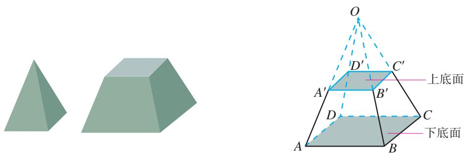

# 棱台

## 高中必修 第二册·人教A版数学

如图 8.1-8，用一个平行于棱锥底面的平面去截棱锥，我们把底面和截面之间那部分多面体叫做棱台（frustum of a pyramid）。图 8.1-1 中的储物箱就给我们以棱台的形象。在棱台中，原棱锥的底面和截面分别叫做棱台的下底面和上底面。类似于棱柱、棱锥，棱台也有侧面、侧棱、顶点。

请你仿照棱锥中侧面、侧棱、顶点的定义，给出棱台侧面、侧棱、顶点的定义，并在图8.1-8中标出它们.

  
图8.1-8

棱台用表示底面各顶点的字母来表示，如图 8.1-8 中的棱台记作棱台 ABCD-A'B'C'D'。由三棱锥、四棱锥、五棱锥……截得的棱台分别叫做三棱台、四棱台、五棱台……

## 本节例题与练习

- [习题8.1 复习巩固 第1题](../%E4%B9%A0%E9%A2%98/Q070000000654.md)
- [习题8.1 复习巩固 第2题](../%E4%B9%A0%E9%A2%98/Q070000000655.md)
- [习题8.1 复习巩固 第3题](../%E4%B9%A0%E9%A2%98/Q070000000656.md)
- [习题8.1 复习巩固 第4题](../%E4%B9%A0%E9%A2%98/Q070000000657.md)
- [习题8.1 复习巩固 第5题](../%E4%B9%A0%E9%A2%98/Q070000000658.md)
- [习题8.1 拓广探索 第10题](../%E4%B9%A0%E9%A2%98/Q070000000663.md)
- [习题8.1 综合运用 第6题](../%E4%B9%A0%E9%A2%98/Q070000000659.md)
- [习题8.1 综合运用 第7题](../%E4%B9%A0%E9%A2%98/Q070000000660.md)
- [习题8.1 综合运用 第8题](../%E4%B9%A0%E9%A2%98/Q070000000661.md)
- [习题8.1 综合运用 第9题](../%E4%B9%A0%E9%A2%98/Q070000000662.md)
- [例 1 将下列各类几何体之间的关系用](../%E4%B9%A0%E9%A2%98/Q070000000640.md)
- [练习 1](../%E4%B9%A0%E9%A2%98/Q070000000641.md)
- [练习 1](../%E4%B9%A0%E9%A2%98/Q070000000650.md)
- [练习 2](../%E4%B9%A0%E9%A2%98/Q070000000642.md)
- [练习 2](../%E4%B9%A0%E9%A2%98/Q070000000651.md)
- [练习 3](../%E4%B9%A0%E9%A2%98/Q070000000643.md)
- [练习 3](../%E4%B9%A0%E9%A2%98/Q070000000652.md)
- [练习 4](../%E4%B9%A0%E9%A2%98/Q070000000645.md)
- [练习 4](../%E4%B9%A0%E9%A2%98/Q070000000644.md)
- [练习 4](../%E4%B9%A0%E9%A2%98/Q070000000653.md)
- [练习 5](../%E4%B9%A0%E9%A2%98/Q070000000646.md)
- [练习 6](../%E4%B9%A0%E9%A2%98/Q070000000647.md)
- [练习 7](../%E4%B9%A0%E9%A2%98/Q070000000648.md)
- [练习 8](../%E4%B9%A0%E9%A2%98/Q070000000649.md)

## 所属组织

- [8.1 基本立体图形](../%E7%9F%A5%E8%AF%86%E4%B8%B2%E8%81%94/%E4%BA%BA%E6%95%99A-%E5%BF%85%E4%BF%AE%E7%AC%AC%E4%BA%8C%E5%86%8C/%E7%AC%AC%E5%85%AB%E7%AB%A0%20%E7%AB%8B%E4%BD%93%E5%87%A0%E4%BD%95%E5%88%9D%E6%AD%A5/8.1%20%E5%9F%BA%E6%9C%AC%E7%AB%8B%E4%BD%93%E5%9B%BE%E5%BD%A2/8.1%20%E5%9F%BA%E6%9C%AC%E7%AB%8B%E4%BD%93%E5%9B%BE%E5%BD%A2.md)

## 相关练习组织（范围关联）

- [8.1 基本立体图形](../%E9%A2%98%E5%9E%8B/%E6%8C%89%E7%AB%A0%E8%8A%82%E5%88%86%E7%B1%BB/%E4%BA%BA%E6%95%99A-%E5%BF%85%E4%BF%AE%E7%AC%AC%E4%BA%8C%E5%86%8C/%E7%AC%AC%E5%85%AB%E7%AB%A0%20%E7%AB%8B%E4%BD%93%E5%87%A0%E4%BD%95%E5%88%9D%E6%AD%A5/8.1%20%E5%9F%BA%E6%9C%AC%E7%AB%8B%E4%BD%93%E5%9B%BE%E5%BD%A2.md)
