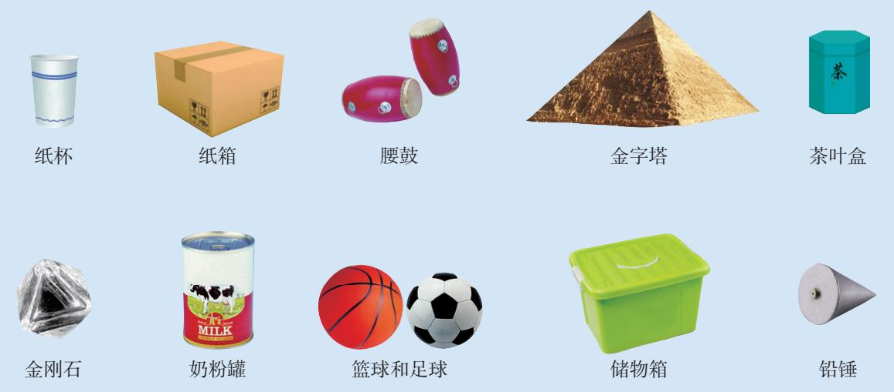
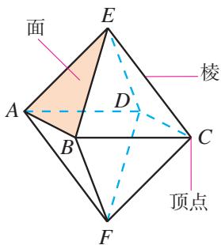
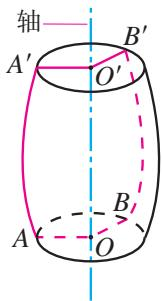

# 棱柱的结构特征

## 高中必修 第二册·人教A版数学

观察

如图8.1-1，这些图片中的物体具有怎样的形状？在日常生活中，我们把这些物体的形状叫做什么？如何描述它们的形状？

  
图8.1-1

观察一个物体，将它抽象成空间几何体，并描述它的结构特征，应先从整体入手，想象围成物体的每个面的形状、面与面之间的关系，并注意利用平面图形的知识.

在图8.1-1中，可以发现纸箱、金字塔、茶叶盒、金刚石、储物箱等物体有相同的特点：围成它们的每个面都是平面图形，并且都是平面多边形；纸杯、腰鼓、奶粉罐、篮球

和足球、铅锤等物体也有相同的特点：围成它们的面不全是平面图形，有些面是曲面.

一般地，由若干个平面多边形围成的几何体叫做多面体（polyhedron）（图8.1-2）。围成多面体的各个多边形叫做多面体的面，如面ABE，面BAF；两个面的公共边叫做多面

在空间几何体中说某个面是多边形，一般也包括这个多边形内部的平面部分.

体的棱，如棱 $AE$ ，棱 $EC$ ；棱与棱的公共点叫做多面体的顶点，如顶点 $E$ ，顶点 $C$ 。图8.1-1中的纸箱、金字塔、茶叶盒、储物箱等物体都具有多面体的形状。

  
图8.1-2

  
图8.1-3

一条平面曲线（包括直线）绕它所在平面内的一条定直线旋转所形成的曲面叫做旋转面，封闭的旋转面围成的几何体叫做旋转体（solid of rotation）。这条定直线叫做旋转体的轴。图8.1-3中的旋转体就是由平面曲线 $OAA'O'$ 绕轴 $OO'$ 旋转形成的。图8.1-1中的纸杯、奶粉罐、篮球和足球、铅锤等物体都具有旋转体的形状。

下面，我们从多面体和旋转体组成元素的形状、位置关系入手，进一步认识一些特殊的多面体和旋转体.

## 本节例题与练习

- [习题8.1 复习巩固 第1题](../%E4%B9%A0%E9%A2%98/Q070000000654.md)
- [习题8.1 复习巩固 第2题](../%E4%B9%A0%E9%A2%98/Q070000000655.md)
- [习题8.1 复习巩固 第3题](../%E4%B9%A0%E9%A2%98/Q070000000656.md)
- [习题8.1 复习巩固 第4题](../%E4%B9%A0%E9%A2%98/Q070000000657.md)
- [习题8.1 复习巩固 第5题](../%E4%B9%A0%E9%A2%98/Q070000000658.md)
- [习题8.1 拓广探索 第10题](../%E4%B9%A0%E9%A2%98/Q070000000663.md)
- [习题8.1 综合运用 第6题](../%E4%B9%A0%E9%A2%98/Q070000000659.md)
- [习题8.1 综合运用 第7题](../%E4%B9%A0%E9%A2%98/Q070000000660.md)
- [习题8.1 综合运用 第8题](../%E4%B9%A0%E9%A2%98/Q070000000661.md)
- [习题8.1 综合运用 第9题](../%E4%B9%A0%E9%A2%98/Q070000000662.md)
- [例 1 将下列各类几何体之间的关系用](../%E4%B9%A0%E9%A2%98/Q070000000640.md)
- [练习 1](../%E4%B9%A0%E9%A2%98/Q070000000641.md)
- [练习 1](../%E4%B9%A0%E9%A2%98/Q070000000650.md)
- [练习 2](../%E4%B9%A0%E9%A2%98/Q070000000642.md)
- [练习 2](../%E4%B9%A0%E9%A2%98/Q070000000651.md)
- [练习 3](../%E4%B9%A0%E9%A2%98/Q070000000643.md)
- [练习 3](../%E4%B9%A0%E9%A2%98/Q070000000652.md)
- [练习 4](../%E4%B9%A0%E9%A2%98/Q070000000645.md)
- [练习 4](../%E4%B9%A0%E9%A2%98/Q070000000644.md)
- [练习 4](../%E4%B9%A0%E9%A2%98/Q070000000653.md)
- [练习 5](../%E4%B9%A0%E9%A2%98/Q070000000646.md)
- [练习 6](../%E4%B9%A0%E9%A2%98/Q070000000647.md)
- [练习 7](../%E4%B9%A0%E9%A2%98/Q070000000648.md)
- [练习 8](../%E4%B9%A0%E9%A2%98/Q070000000649.md)

## 所属组织

- [8.1 基本立体图形](../%E7%9F%A5%E8%AF%86%E4%B8%B2%E8%81%94/%E4%BA%BA%E6%95%99A-%E5%BF%85%E4%BF%AE%E7%AC%AC%E4%BA%8C%E5%86%8C/%E7%AC%AC%E5%85%AB%E7%AB%A0%20%E7%AB%8B%E4%BD%93%E5%87%A0%E4%BD%95%E5%88%9D%E6%AD%A5/8.1%20%E5%9F%BA%E6%9C%AC%E7%AB%8B%E4%BD%93%E5%9B%BE%E5%BD%A2/8.1%20%E5%9F%BA%E6%9C%AC%E7%AB%8B%E4%BD%93%E5%9B%BE%E5%BD%A2.md)

## 相关练习组织（范围关联）

- [8.1 基本立体图形](../%E9%A2%98%E5%9E%8B/%E6%8C%89%E7%AB%A0%E8%8A%82%E5%88%86%E7%B1%BB/%E4%BA%BA%E6%95%99A-%E5%BF%85%E4%BF%AE%E7%AC%AC%E4%BA%8C%E5%86%8C/%E7%AC%AC%E5%85%AB%E7%AB%A0%20%E7%AB%8B%E4%BD%93%E5%87%A0%E4%BD%95%E5%88%9D%E6%AD%A5/8.1%20%E5%9F%BA%E6%9C%AC%E7%AB%8B%E4%BD%93%E5%9B%BE%E5%BD%A2.md)
