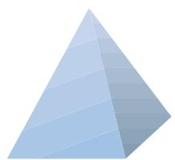
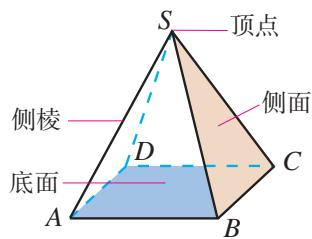

# 棱锥

## 高中必修 第二册·人教A版数学

像图8.1-1中金字塔这样的多面体，均由平面图形围成，其中一个面是多边形，其余各面都是三角形，并且这些三角形有一个公共顶点.

如图8.1-7，一般地，有一个面是多边形，其余各面都是有一个公共顶点的三角形，由这些面所围成的多面体叫做棱锥（pyramid）。这个多边形面叫做棱锥的底面；有公共顶点的各个三角形面叫做棱锥的侧面；相邻侧面的公共边叫做棱锥的侧棱；各侧面的公共顶点叫做棱锥的顶点。

  
图8.1-7

棱锥用表示顶点和底面各顶点的字母来表示，如图 8.1-7 中的棱锥记作棱锥 S-ABCD。棱锥的底面可以是三角形、四边形、五边形……，我们把这样的棱锥分别叫做三棱锥、四棱锥、五棱锥……，其中三棱锥又叫四面体。底面是正多边形，并且顶点与底面中心的连线垂直于底面的棱锥叫做正棱锥。
