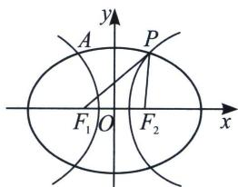

# 椭圆与双曲线的共焦点关系

## 2026版高中《mst老唐说题》圆锥曲线专题（数学）

## 五、椭圆双曲线共焦点问题

椭圆双曲线共焦点三角形的问题：如图17，椭圆 $\frac{x^2}{a^2} +\frac{y^2}{b^2} = 1$ 和双曲线 $\frac{x^2}{a^2} -\frac{y^2}{b^2} = 1$ 共焦点，由于两个式子 $a,b$ 不同，将椭圆写成 $\frac{x^2}{m} +\frac{y^2}{n} = 1(m > 0,n > 0)$ ，双曲线写成 $\frac{x^2}{p} -\frac{y^2}{q} = 1(p > 0,q > 0)$ 可以知道 $S_{\triangle F_1PF_2}$ $= n\cdot \frac{\sin\alpha}{1 + \cos\alpha} = q\cdot \frac{\sin\alpha}{1 - \cos\alpha}\Rightarrow \frac{n}{1 + \cos\alpha} = \frac{q}{1 - \cos\alpha}\Rightarrow \cos \alpha = \frac{n - q}{n + q},|PF_1|\cdot |PF_2| = m - p = n + q$

①当 $PF_{1} \perp PF_{2}$ 时，椭圆和双曲线的离心率 $e_{\text{椭}} = \frac{2c}{2a} = \frac{|F_{1}F_{2}|}{|PF_{1}| + |PF_{2}|}; e_{\text{双}} = \frac{2c}{2a} = \frac{|F_{1}F_{2}|}{||PF_{1}| - |PF_{2}||};$ $\frac{1}{e_{\text{椭}}^2} + \frac{1}{e_{\text{双}}^2} = \frac{(|PF_1| + |PF_2|)^2}{|F_1F_2|^2} + \frac{(|PF_1| - |PF_2|)^2}{|F_1F_2|^2} = \frac{2(|PF_1|^2 + |PF_2|^2)}{|F_1F_2|^2} = 2$

②当 $\angle F_{1}PF_{2} = \alpha$ 时，一定有 $\frac{1 - \cos\alpha}{e_{\text{椭}}^{2}} +\frac{1 + \cos\alpha}{e_{\text{双}}^{2}} = 2\Rightarrow \frac{\sin^{2}\frac{\alpha}{2}}{e_{\text{椭}}^{2}} +\frac{\cos^{2}\frac{\alpha}{2}}{e_{\text{双}}^{2}} = 1.$

证明： $\frac{a_{\text{椭}}^2 - c^2}{1 + \cos\alpha} = \frac{c^2 - a_{\text{双}}^2}{1 - \cos\alpha}\Rightarrow \frac{\frac{1}{e_{\text{椭}}^2} - 1}{2\cos^2\frac{\alpha}{2}} = \frac{1 - \frac{1}{e_{\text{双}}^2}}{2\sin^2\frac{\alpha}{2}}\Rightarrow \frac{\sin^2\frac{\alpha}{2}}{e_{\text{椭}}^2} +\frac{\cos^2\frac{\alpha}{2}}{e_{\text{双}}^2} = 1.$

## 相关原子

- [双曲线的定义与标准方程](%E5%8F%8C%E6%9B%B2%E7%BA%BF%E7%9A%84%E5%AE%9A%E4%B9%89%E4%B8%8E%E6%A0%87%E5%87%86%E6%96%B9%E7%A8%8B.md)
- [椭圆的定义与标准方程](%E6%A4%AD%E5%9C%86%E7%9A%84%E5%AE%9A%E4%B9%89%E4%B8%8E%E6%A0%87%E5%87%86%E6%96%B9%E7%A8%8B.md)

## 所属组织

- [五、椭圆双曲线共焦点问题](../%E9%A2%98%E5%9E%8B/%E6%8C%89%E9%A2%98%E5%9E%8B%E5%88%86%E7%B1%BB/%E5%9C%86%E9%94%A5%E6%9B%B2%E7%BA%BF/%E5%87%A0%E4%BD%95%E8%A7%86%E8%A7%92%E4%B8%8B%E7%9A%84%E7%84%A6%E7%82%B9%E4%B8%89%E8%A7%92%E5%BD%A2/%E7%AC%AC%E4%B8%80%E8%8A%82_%E8%A7%92%E5%BA%A6%E8%AF%AD%E8%A8%80%E4%B8%8E%E5%9D%90%E6%A0%87%E8%AF%AD%E8%A8%80%E4%B8%8B%E7%9A%84%E7%84%A6%E7%82%B9%E4%B8%89%E8%A7%92%E5%BD%A2/%E4%BA%94_%E6%A4%AD%E5%9C%86%E5%8F%8C%E6%9B%B2%E7%BA%BF%E5%85%B1%E7%84%A6%E7%82%B9%E9%97%AE%E9%A2%98.md)

## 题型训练 · 2026版高中《mst老唐说题》圆锥曲线专题（数学）

### 几何视角下的焦点三角形 / 第一节 角度语言与坐标语言下的焦点三角形

> [!example]- 五、椭圆双曲线共焦点问题
> 

### 小题新题型与多选的综合题方法篇 / 第三节 圆锥曲线之间的交点

> [!example]- 二、由斜率关系和共焦点构造的混合型
> 
