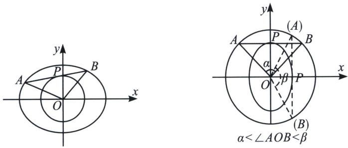

# 椭圆内切圆切线三角形的面积最值

## 2026版高中《mst老唐说题》圆锥曲线专题（数学）

## 二、切点圆面积最值

若椭圆内含有圆与直线相切，如图直线 $AB$ 与圆相切于 $P$ ，交椭圆 $\frac{x^2}{a^2} +\frac{y^2}{b^2} = 1$ 于点 $A$ ， $B$ 求 $S_{\triangle OAB}$ 的最大值，

首先进行仿射变换： $\frac{x^{2}}{a^{2}}+\frac{y^{2}}{b^{2}}=1$ ，令 $\left\{\begin{aligned}x^{\prime}&=x\\ y^{\prime}&=\frac{a}{b}y\end{aligned}\right.\Rightarrow\left\{\begin{aligned}x^{\prime2}&+y^{\prime2}=a^{2}\\ x^{\prime2}&+\frac{b^{2}y^{\prime2}}{a^{2}}=r^{2}\end{aligned}\right.$ ，拉伸后可知， $S_{\triangle AOB}=\frac{b}{a}S_{\triangle A^{\prime}OB^{\prime}}$ ，故当 $S_{\triangle A^{\prime}OB^{\prime}}=\frac{1}{2}a^{2}\sin\angle A^{\prime}OB^{\prime}$ 最大时， $\angle A^{\prime}OB^{\prime}=90^{\circ}$ ，关键在于看 $\angle A^{\prime}OB^{\prime}$ 的取值范围；

根据几何性质， $A^{\prime}B^{\prime}$ 平行于 x 轴时， $\angle A^{\prime}OB^{\prime}=\alpha$ 最小， $A^{\prime}B^{\prime}$ 平行于轴 y 时， $\angle A^{\prime}OB^{\prime}=\beta$ 最大.

## 相关原子

- [圆的标准方程及其推导](%E5%9C%86%E7%9A%84%E6%A0%87%E5%87%86%E6%96%B9%E7%A8%8B%E5%8F%8A%E5%85%B6%E6%8E%A8%E5%AF%BC.md)
- [椭圆的定义与标准方程](%E6%A4%AD%E5%9C%86%E7%9A%84%E5%AE%9A%E4%B9%89%E4%B8%8E%E6%A0%87%E5%87%86%E6%96%B9%E7%A8%8B.md)

## 所属组织

- [二、切点圆面积最值](../%E9%A2%98%E5%9E%8B/%E6%8C%89%E9%A2%98%E5%9E%8B%E5%88%86%E7%B1%BB/%E5%9C%86%E9%94%A5%E6%9B%B2%E7%BA%BF/%E6%96%B0%E5%AE%9A%E4%B9%89%E4%B8%8B%E7%9A%84%E6%96%9C%E7%8E%87%E8%B0%83%E6%95%B4%E4%B8%8E%E4%BB%BF%E5%B0%84/%E7%AC%AC%E4%BA%8C%E8%8A%82_%E4%BB%BF%E5%B0%84%E6%B3%95%E4%B8%8E%E9%9D%A2%E7%A7%AF%E8%BD%AC%E5%8C%96/%E4%BA%8C_%E5%88%87%E7%82%B9%E5%9C%86%E9%9D%A2%E7%A7%AF%E6%9C%80%E5%80%BC.md)

## 题型训练 · 2026版高中《mst老唐说题》圆锥曲线专题（数学）

### 新定义下的斜率调整与仿射 / 第二节 仿射法与面积转化

> [!example]- 二、切点圆面积最值
> 
