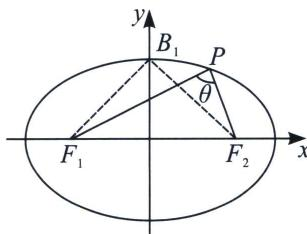

# 椭圆焦点张角与离心率范围

## 2026版高中《mst老唐说题》圆锥曲线专题（数学）

## 一、短轴端点处 $\angle F_{1}PF_{2}$ 张角最大

这是我们之前就介绍过得内容，已知椭圆 $\frac{x^2}{a^2} +\frac{y^2}{b^2} = 1(a > b > 0)$ 的左、右两焦点分别为 $F_{1}$ 、 $F_{2}$ ，若椭圆上存在一点 $P$ ，使得 $\angle F_1PF_2 = \theta$ ，则椭圆离心率 $e\in \left[\sin \frac{\theta}{2},1\right)$

证明：如图，设 $B_{1}$ 为椭圆的短轴顶点，假设椭圆上存在一点 $P$ ，使得 $\angle F_{1}PF_{2} = \theta$ ，则必有 $\angle F_{1}B_{1}F_{2} \geqslant \theta$ ，又 $e = \sin \frac{\angle F_{1}B_{1}F_{2}}{2}$ ，由于 $\frac{\theta}{2} \leqslant \frac{\angle F_{1}B_{1}F_{2}}{2} < \frac{\pi}{2}$ ，故 $e \in \left[\sin \frac{\theta}{2}, 1\right)$ .

## 相关原子

- [椭圆的定义与标准方程](%E6%A4%AD%E5%9C%86%E7%9A%84%E5%AE%9A%E4%B9%89%E4%B8%8E%E6%A0%87%E5%87%86%E6%96%B9%E7%A8%8B.md)
- [椭圆的离心率](%E6%A4%AD%E5%9C%86%E7%9A%84%E7%A6%BB%E5%BF%83%E7%8E%87.md)

## 所属组织

- [一、短轴端点处 $\angle F_{1}PF_{2}$ 张角最大](../%E7%9F%A5%E8%AF%86%E4%B8%B2%E8%81%94/mst%E8%80%81%E5%94%90%E8%AF%B4%E9%A2%98-%E5%9C%86%E9%94%A5%E6%9B%B2%E7%BA%BF-2026/%E4%B8%8A%E5%86%8C/%E7%AC%AC02%E7%AB%A0_%E7%A6%BB%E5%BF%83%E7%8E%87/%E7%AC%AC%E4%B8%89%E8%8A%82_%E9%95%BF%E5%BA%A6%E4%B8%8E%E8%A7%92%E5%BA%A6%E4%B8%8B%E7%9A%84%E7%A6%BB%E5%BF%83%E7%8E%87%E8%8C%83%E5%9B%B4%E7%BA%A6%E6%9D%9F/%E4%B8%80_%E7%9F%AD%E8%BD%B4%E7%AB%AF%E7%82%B9%E5%A4%84_angle_F__1_PF__2__%E5%BC%A0%E8%A7%92%E6%9C%80%E5%A4%A7/%E4%B8%80_%E7%9F%AD%E8%BD%B4%E7%AB%AF%E7%82%B9%E5%A4%84_angle_F__1_PF__2__%E5%BC%A0%E8%A7%92%E6%9C%80%E5%A4%A7.md)

## 题型训练 · 2026版高中《mst老唐说题》圆锥曲线专题（数学）

### 离心率 / 第三节 长度与角度下的离心率范围约束

> [!example]- 一、短轴端点处 $\angle F_{1}PF_{2}$ 张角最大
> 
