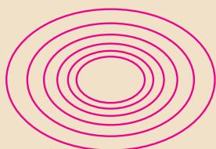
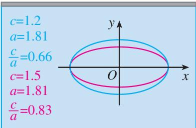

# 椭圆的离心率

## 高中选择性必修 第一册·人教A版数学

思考

观察图3.1-9，我们发现，不同形状的椭圆的扁平程度不同，相同形状的椭圆的扁平程度相同。扁平程度是椭圆的重要形状特征，你能用适当的量定量刻画椭圆的扁平程度吗？

  
图3.1-9

如图3.1-10，椭圆 $\frac{x^2}{a^2} +\frac{y^2}{b^2} = 1(a > b > 0)$ 的长半轴长为 $a$ ，半焦距为 $c$ .利用信息技术，保持长半轴长 $a$ 不变，改变椭圆的半焦距 $c$ ，可以发现， $c$ 越接近 $a$ ，椭圆越扁平．类似地，保持 $c$ 不变，改变 $a$ 的大小，则 $a$ 越接近 $c$ ，椭圆越扁平；而当 $a,c$ 扩大或缩小相同倍数时，椭圆的形状不变

这样，利用 c 和 a 这两个量，可以刻画椭圆的扁平程度.

  
图3.1-10

我们把椭圆的焦距与长轴长的比 $\frac{c}{a}$ 称为椭圆的离心率①，用 $e$ 表示，即 $e = \frac{c}{a}$ .

因为 $a > c > 0$ ，所以 $0 < e < 1$ . $e$ 越接近1， $c$ 越接近 $a$ ， $b = \sqrt{a^2 - c^2}$ 就越小，因此椭圆越扁平；反之， $e$ 越接近0， $c$ 越接近0， $b$ 越接近 $a$ ，这时椭圆就越接近于圆.

你能运用三角函数的知识解释，为什么 $e = \frac{c}{a}$ 越大，椭圆越扁平？ $e = \frac{c}{a}$ 越小，椭圆越接近于圆吗？

当且仅当 a=b 时，c=0，这时两个焦点重合，图形变为圆，它的方程为

$$
x ^ {2} + y ^ {2} = a ^ {2}.
$$
