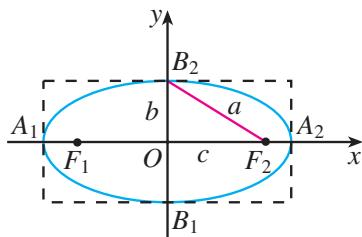
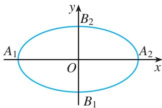

# 椭圆的范围对称性与顶点

## 高中选择性必修 第一册·人教A版数学

观察

观察椭圆 $\frac{x^2}{a^2} +\frac{y^2}{b^2} = 1$ （ $a > b > 0$ ）的形状，你能从图上看出它的范围吗？它具有怎样的对称性？椭圆上哪些点比较特殊？

思考

观察图3.1-7，容易看出椭圆上的点都在一个特定的矩形内，你能利用方程（代数方法）确定出它的具体边界吗？

由方程 $\frac{x^2}{a^2} +\frac{y^2}{b^2} = 1(a > b > 0)$ ，可知

$$
\frac {y ^ {2}}{b ^ {2}} = 1 - \frac {x ^ {2}}{a ^ {2}} \geqslant 0,
$$

所以，椭圆上点的横坐标都适合不等式

  
图3.1-7

即

$$
\begin{array}{l} \frac {x ^ {2}}{a ^ {2}} \leqslant 1, \\ - a \leqslant x \leqslant a. \end{array}
$$

同理有

$$
\frac {y ^ {2}}{b ^ {2}} \leqslant 1,
$$

即

$$
- b \leqslant y \leqslant b.
$$

这说明椭圆位于直线 $x = \pm a$ 和 $y = \pm b$ 围成的矩形框里（图3.1-7）.

探究

观察椭圆的形状，可以发现椭圆既是轴对称图形，又是中心对称图形。如何利用方程说明椭圆的对称性？

在椭圆的标准方程 $\frac{x^2}{a^2} +\frac{y^2}{b^2} = 1 (a > b > 0)$ 中，以一 $y$ 代 $y$ ，方程不变．这说明当点 $P(x,y)$ 在椭圆上时，它关于 $x$ 轴的对称点 $P_{1}(x, - y)$ 也在椭圆上，所以椭圆关于 $x$ 轴对称．同理，以一 $x$ 代 $x$ ，方程也不变，这说明如果点 $P(x,y)$ 在椭圆上，那么它关于 $y$ 轴的对称点 $P_{2}(-x,y)$ 也在椭圆上，所以椭圆关于 $y$ 轴对称．以一 $x$ 代 $x$ ，以一 $y$ 代 $y$ 方程也不变，这说明当点 $P(x, y)$ 在椭圆上时，它关于原点的对称点 $P_{3}(-x, -y)$ 也在椭圆上，所以椭圆关于原点对称.

综上，椭圆关于 $x$ 轴、 $y$ 轴都是对称的。这时，坐标轴是椭圆的对称轴，原点是椭圆的对称中心，椭圆的对称中心叫做椭圆的中心。

思考

你认为椭圆 $\frac{x^2}{a^2} +\frac{y^2}{b^2} = 1 (a > b > 0)$ 上哪些点比较特殊？为什么？如何得到这些点的坐标？

在椭圆的标准方程 $\frac{x^2}{a^2} +\frac{y^2}{b^2} = 1(a > b > 0)$ 中，令 $x = 0$ ，得 $y = \pm b$ 因此 $B_{1}(0, - b)$ ， $B_{2}(0,b)$ 是椭圆与 $y$ 轴的两个交点同理，令 $y = 0$ ，得 $x = \pm a$ 因此 $A_{1}(-a,0),A_{2}(a,0)$ 是椭圆与 $x$ 轴的两个交点．因为 $x$ 轴、 $y$ 轴是椭圆的对称轴，所以椭圆与它的对称轴有四个交点，这四个交点叫做椭圆的顶点（图3.1-8).

  
图3.1-8

线段 $A_{1}A_{2}$ ， $B_{1}B_{2}$ 分别叫做椭圆的长轴和短轴，它们的长分别等于 2a 和 2b，a 和 b 分别叫做椭圆的长半轴长和短半轴长.
